# SCREENSHOT CLEANUP PLAN (SAFE MODE DRY RUN)

**Goal:** Delete only screenshots captured by this tool that do NOT show the UI of `com.pasindu.nursingotapp`.
**Strict Safety Guarantee:** No personal photos, downloads, or unrelated files are affected. No source code, app data, or device settings are changed.

## Summary Statistics
- **Total Screenshots Scanned:** 133
- **KEEP (Shows App UI):** 112
- **DELETE-CANDIDATE (Does NOT Show App UI / Corrupted):** 20
- **UNSURE (Treat as KEEP):** 1

---

## 1. DELETE-CANDIDATE TABLE (Files to Delete Upon Confirmation)

| # | File Path | Filename | Size | Created Time | Reason | Thumbnail / Status |
|---|-----------|----------|------|--------------|--------|--------------------|
| 1 | `audit-output/full-ui-audit-2026-11-05/screenshots/DEVICE-002_home_guide_dialog.png` | `DEVICE-002_home_guide_dialog.png` | 621.2 KB | 2026-11-05 22:51:15 | Corrupted 0-frame non-image file generated during earlier ADB screencap attempts via PowerShell stdout redirection (UTF-16LE text mangling). Does NOT display any app UI and cannot be rendered by any image viewer. Not referenced in any documentation. | *(Unrenderable / corrupt UTF-16LE binary)* |
| 2 | `audit-output/full-ui-audit-2026-11-05/screenshots/DEVICE-003_work_initial.png` | `DEVICE-003_work_initial.png` | 621.3 KB | 2026-11-05 22:52:54 | Corrupted 0-frame non-image file generated during earlier ADB screencap attempts via PowerShell stdout redirection (UTF-16LE text mangling). Does NOT display any app UI and cannot be rendered by any image viewer. Not referenced in any documentation. | *(Unrenderable / corrupt UTF-16LE binary)* |
| 3 | `audit-output/full-ui-audit-2026-11-05/screenshots/DEVICE-004_home_scrolled.png` | `DEVICE-004_home_scrolled.png` | 621.3 KB | 2026-11-05 22:55:20 | Corrupted 0-frame non-image file generated during earlier ADB screencap attempts via PowerShell stdout redirection (UTF-16LE text mangling). Does NOT display any app UI and cannot be rendered by any image viewer. Not referenced in any documentation. | *(Unrenderable / corrupt UTF-16LE binary)* |
| 4 | `audit-output/full-ui-audit-2026-11-05/screenshots/DEVICE-005_after_profile_tap.png` | `DEVICE-005_after_profile_tap.png` | 622.6 KB | 2026-11-05 22:56:20 | Corrupted 0-frame non-image file generated during earlier ADB screencap attempts via PowerShell stdout redirection (UTF-16LE text mangling). Does NOT display any app UI and cannot be rendered by any image viewer. Not referenced in any documentation. | *(Unrenderable / corrupt UTF-16LE binary)* |
| 5 | `audit-output/full-ui-audit-2026-11-05/screenshots/current_device_screen.png` | `current_device_screen.png` | 4.26 MB | 2026-11-05 22:46:08 | Corrupted 0-frame non-image file generated during earlier ADB screencap attempts via PowerShell stdout redirection (UTF-16LE text mangling). Does NOT display any app UI and cannot be rendered by any image viewer. Not referenced in any documentation. | *(Unrenderable / corrupt UTF-16LE binary)* |
| 6 | `audit-output/full-ui-audit-2026-11-05/screenshots/device_current.png` | `device_current.png` | 4.29 MB | 2026-11-05 22:31:34 | Corrupted 0-frame non-image file generated during earlier ADB screencap attempts via PowerShell stdout redirection (UTF-16LE text mangling). Does NOT display any app UI and cannot be rendered by any image viewer. Not referenced in any documentation. | *(Unrenderable / corrupt UTF-16LE binary)* |
| 7 | `audit-output/physical-device/screenshots/01_home_screen.png` | `01_home_screen.png` | 658.2 KB | 2026-11-06 02:02:29 | Corrupted 0-frame non-image file generated during earlier ADB screencap attempts via PowerShell stdout redirection (UTF-16LE text mangling). Does NOT display any app UI and cannot be rendered by any image viewer. Not referenced in any documentation. | *(Unrenderable / corrupt UTF-16LE binary)* |
| 8 | `audit-output/physical-device/screenshots/02_claim_period_screen.png` | `02_claim_period_screen.png` | 659.3 KB | 2026-11-06 02:03:32 | Corrupted 0-frame non-image file generated during earlier ADB screencap attempts via PowerShell stdout redirection (UTF-16LE text mangling). Does NOT display any app UI and cannot be rendered by any image viewer. Not referenced in any documentation. | *(Unrenderable / corrupt UTF-16LE binary)* |
| 9 | `audit-output/physical-device/screenshots/03_home_guide_dialog.png` | `03_home_guide_dialog.png` | 556.3 KB | 2026-11-06 02:07:22 | Corrupted 0-frame non-image file generated during earlier ADB screencap attempts via PowerShell stdout redirection (UTF-16LE text mangling). Does NOT display any app UI and cannot be rendered by any image viewer. Not referenced in any documentation. | *(Unrenderable / corrupt UTF-16LE binary)* |
| 10 | `audit-output/physical-device/screenshots/04_profile_screen.png` | `04_profile_screen.png` | 660.1 KB | 2026-11-06 02:13:53 | Corrupted 0-frame non-image file generated during earlier ADB screencap attempts via PowerShell stdout redirection (UTF-16LE text mangling). Does NOT display any app UI and cannot be rendered by any image viewer. Not referenced in any documentation. | *(Unrenderable / corrupt UTF-16LE binary)* |
| 11 | `audit-output/physical-device/screenshots/05_work_screen.png` | `05_work_screen.png` | 659.0 KB | 2026-11-06 02:25:16 | Corrupted 0-frame non-image file generated during earlier ADB screencap attempts via PowerShell stdout redirection (UTF-16LE text mangling). Does NOT display any app UI and cannot be rendered by any image viewer. Not referenced in any documentation. | *(Unrenderable / corrupt UTF-16LE binary)* |
| 12 | `audit-output/physical-device/screenshots/06_daily_entry_screen.png` | `06_daily_entry_screen.png` | 683.2 KB | 2026-11-06 02:27:37 | Corrupted 0-frame non-image file generated during earlier ADB screencap attempts via PowerShell stdout redirection (UTF-16LE text mangling). Does NOT display any app UI and cannot be rendered by any image viewer. Not referenced in any documentation. | *(Unrenderable / corrupt UTF-16LE binary)* |
| 13 | `audit-output/physical-device/screenshots/07_preset_dialog_check.png` | `07_preset_dialog_check.png` | 684.2 KB | 2026-11-06 02:28:19 | Corrupted 0-frame non-image file generated during earlier ADB screencap attempts via PowerShell stdout redirection (UTF-16LE text mangling). Does NOT display any app UI and cannot be rendered by any image viewer. Not referenced in any documentation. | *(Unrenderable / corrupt UTF-16LE binary)* |
| 14 | `audit-output/physical-device/screenshots/08_duty_preset_dialog.png` | `08_duty_preset_dialog.png` | 481.0 KB | 2026-11-06 02:29:26 | Corrupted 0-frame non-image file generated during earlier ADB screencap attempts via PowerShell stdout redirection (UTF-16LE text mangling). Does NOT display any app UI and cannot be rendered by any image viewer. Not referenced in any documentation. | *(Unrenderable / corrupt UTF-16LE binary)* |
| 15 | `audit-output/physical-device/screenshots/09_preset_cancelled.png` | `09_preset_cancelled.png` | 392.8 KB | 2026-11-06 02:30:38 | Corrupted 0-frame non-image file generated during earlier ADB screencap attempts via PowerShell stdout redirection (UTF-16LE text mangling). Does NOT display any app UI and cannot be rendered by any image viewer. Not referenced in any documentation. | *(Unrenderable / corrupt UTF-16LE binary)* |
| 16 | `audit-output/physical-device/screenshots/10_preset_applied_staged.png` | `10_preset_applied_staged.png` | 448.0 KB | 2026-11-06 02:36:19 | Corrupted 0-frame non-image file generated during earlier ADB screencap attempts via PowerShell stdout redirection (UTF-16LE text mangling). Does NOT display any app UI and cannot be rendered by any image viewer. Not referenced in any documentation. | *(Unrenderable / corrupt UTF-16LE binary)* |
| 17 | `audit-output/physical-device/screenshots/11_unsaved_edits_blocker_dialog.png` | `11_unsaved_edits_blocker_dialog.png` | 431.2 KB | 2026-11-06 02:39:22 | Corrupted 0-frame non-image file generated during earlier ADB screencap attempts via PowerShell stdout redirection (UTF-16LE text mangling). Does NOT display any app UI and cannot be rendered by any image viewer. Not referenced in any documentation. | *(Unrenderable / corrupt UTF-16LE binary)* |
| 18 | `audit-output/physical-device/screenshots/check_current.png` | `check_current.png` | 658.6 KB | 2026-11-06 02:04:23 | Corrupted 0-frame non-image file generated during earlier ADB screencap attempts via PowerShell stdout redirection (UTF-16LE text mangling). Does NOT display any app UI and cannot be rendered by any image viewer. Not referenced in any documentation. | *(Unrenderable / corrupt UTF-16LE binary)* |
| 19 | `audit-output/physical-device/screenshots/check_live.png` | `check_live.png` | 426.0 KB | 2026-11-06 02:19:36 | Corrupted 0-frame non-image file generated during earlier ADB screencap attempts via PowerShell stdout redirection (UTF-16LE text mangling). Does NOT display any app UI and cannot be rendered by any image viewer. Not referenced in any documentation. | *(Unrenderable / corrupt UTF-16LE binary)* |
| 20 | `audit-output/redmi-ui-audit-2026-11-05/device_current.png` | `device_current.png` | 4.29 MB | 2026-11-05 12:48:26 | Corrupted 0-frame non-image file generated during earlier ADB screencap attempts via PowerShell stdout redirection (UTF-16LE text mangling). Does NOT display any app UI and cannot be rendered by any image viewer. Not referenced in any documentation. | *(Unrenderable / corrupt UTF-16LE binary)* |

---

## 2. UNSURE TABLE (Treated as KEEP)

| # | File Path | Filename | Size | Created Time | Reason | Thumbnail / Status |
|---|-----------|----------|------|--------------|--------|--------------------|
| 1 | `audit-output/full-ui-audit-2026-11-05/screenshots/DEVICE-001_home_initial.png` | `DEVICE-001_home_initial.png` | 621.9 KB | 2026-11-05 22:49:44 | Corrupted/unrenderable capture from PowerShell stdout redirection, but referenced by name in UI_AUDIT_REPORT.md and UI_AUDIT_REMEDIATION_TRACKER.md. Classified as UNSURE (preserved) to prevent broken documentation references. | *(Unrenderable / corrupt UTF-16LE binary)* |

---

## 3. KEEP TABLE (Preserved Screenshots Showing App UI)

| # | File Path | Filename | Size | Created Time | App Screen / Content Verified | Thumbnail |
|---|-----------|----------|------|--------------|------------------------------|-----------|
| 1 | `audit-output/current_screen2.png` | `current_screen2.png` | 305.0 KB | 2026-11-05 14:44:04 | Shows NursingOTApp UI (App UI verification screen) | 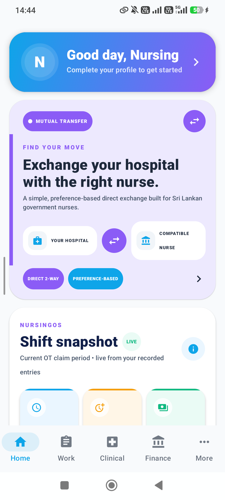 |
| 2 | `audit-output/full-ui-audit-2026-11-05/screenshots/01_home_guide_dialog.png` | `01_home_guide_dialog.png` | 253.7 KB | 2026-11-05 22:31:34 | Shows NursingOTApp UI (Home screen / hero / shift snapshot / guide dialog) |  |
| 3 | `audit-output/full-ui-audit-2026-11-05/screenshots/01_home_initial.png` | `01_home_initial.png` | 277.8 KB | 2026-11-05 22:31:34 | Shows NursingOTApp UI (Home screen / hero / shift snapshot / guide dialog) |  |
| 4 | `audit-output/full-ui-audit-2026-11-05/screenshots/01_home_scrolled.png` | `01_home_scrolled.png` | 189.0 KB | 2026-11-05 22:31:34 | Shows NursingOTApp UI (Home screen / hero / shift snapshot / guide dialog) |  |
| 5 | `audit-output/full-ui-audit-2026-11-05/screenshots/02_work_initial.png` | `02_work_initial.png` | 303.7 KB | 2026-11-05 22:31:34 | Shows NursingOTApp UI (Work / OT & Claims / Planner / Duty Presets) |  |
| 6 | `audit-output/full-ui-audit-2026-11-05/screenshots/02_work_scrolled.png` | `02_work_scrolled.png` | 161.2 KB | 2026-11-05 22:31:34 | Shows NursingOTApp UI (Work / OT & Claims / Planner / Duty Presets) |  |
| 7 | `audit-output/full-ui-audit-2026-11-05/screenshots/03_clinical_initial.png` | `03_clinical_initial.png` | 404.5 KB | 2026-11-05 22:31:34 | Shows NursingOTApp UI (Clinical Tools / Calculators / Bedside Navigation) |  |
| 8 | `audit-output/full-ui-audit-2026-11-05/screenshots/03_clinical_scrolled.png` | `03_clinical_scrolled.png` | 203.5 KB | 2026-11-05 22:31:34 | Shows NursingOTApp UI (Clinical Tools / Calculators / Bedside Navigation) | 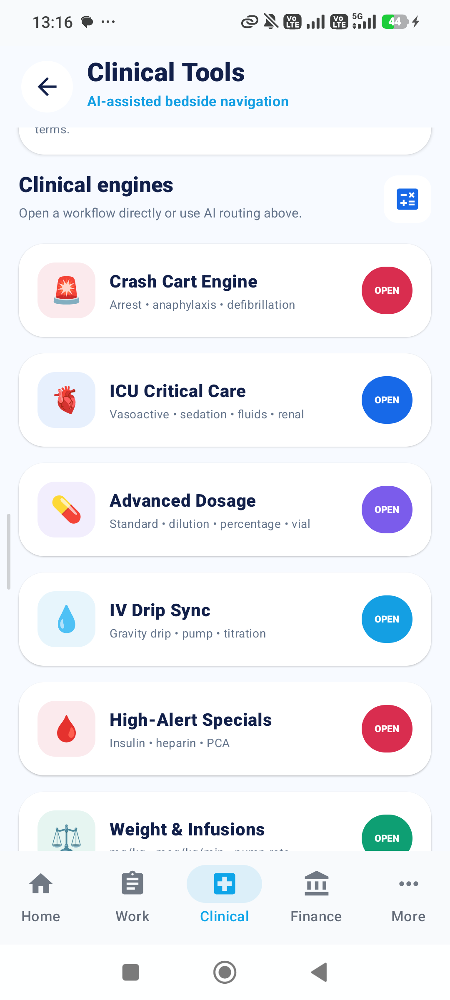 |
| 9 | `audit-output/full-ui-audit-2026-11-05/screenshots/04_finance_initial.png` | `04_finance_initial.png` | 464.6 KB | 2026-11-05 22:31:34 | Shows NursingOTApp UI (Advanced Finance Hub / Earnings / OT calculations) |  |
| 10 | `audit-output/full-ui-audit-2026-11-05/screenshots/04_finance_scrolled.png` | `04_finance_scrolled.png` | 169.1 KB | 2026-11-05 22:31:34 | Shows NursingOTApp UI (Advanced Finance Hub / Earnings / OT calculations) | 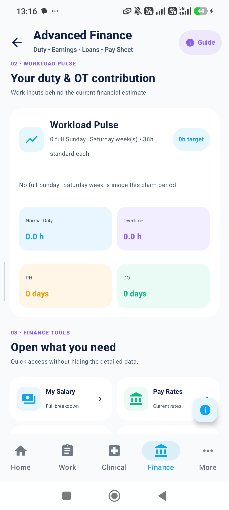 |
| 11 | `audit-output/full-ui-audit-2026-11-05/screenshots/05_more_article_reader.png` | `05_more_article_reader.png` | 224.6 KB | 2026-11-05 22:31:34 | Shows NursingOTApp UI (Knowledge Hub / Article Reader / Evidence Library) | 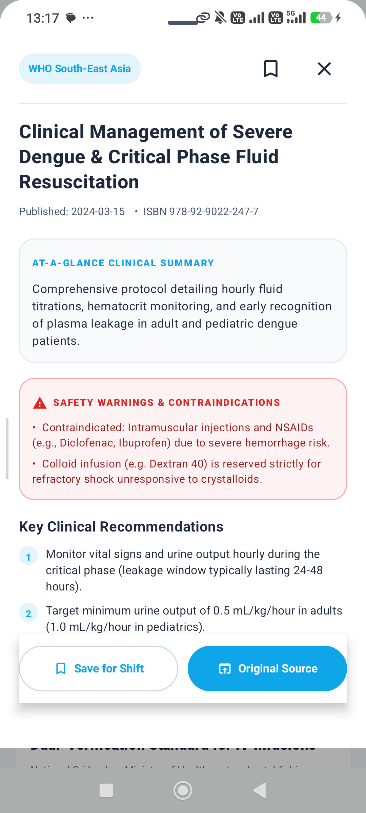 |
| 12 | `audit-output/full-ui-audit-2026-11-05/screenshots/05_more_article_reader_scrolled.png` | `05_more_article_reader_scrolled.png` | 224.6 KB | 2026-11-05 22:31:34 | Shows NursingOTApp UI (Knowledge Hub / Article Reader / Evidence Library) | 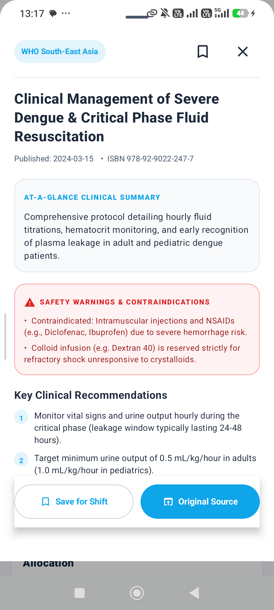 |
| 13 | `audit-output/full-ui-audit-2026-11-05/screenshots/05_more_clinical_planning.png` | `05_more_clinical_planning.png` | 183.3 KB | 2026-11-05 22:31:34 | Shows NursingOTApp UI (Clinical Tools / Calculators / Bedside Navigation) | 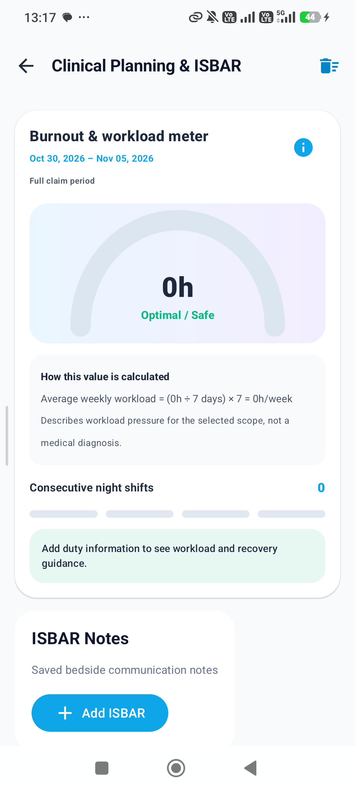 |
| 14 | `audit-output/full-ui-audit-2026-11-05/screenshots/05_more_command_center.png` | `05_more_command_center.png` | 349.3 KB | 2026-11-05 22:31:34 | Shows NursingOTApp UI (Nurse Command Center) |  |
| 15 | `audit-output/full-ui-audit-2026-11-05/screenshots/05_more_initial.png` | `05_more_initial.png` | 321.9 KB | 2026-11-05 22:31:34 | Shows NursingOTApp UI (More Tools hub navigation) |  |
| 16 | `audit-output/full-ui-audit-2026-11-05/screenshots/05_more_knowledge_hub.png` | `05_more_knowledge_hub.png` | 473.0 KB | 2026-11-05 22:31:34 | Shows NursingOTApp UI (Knowledge Hub / Article Reader / Evidence Library) |  |
| 17 | `audit-output/full-ui-audit-2026-11-05/screenshots/05_more_knowledge_hub_scrolled.png` | `05_more_knowledge_hub_scrolled.png` | 210.1 KB | 2026-11-05 22:31:34 | Shows NursingOTApp UI (Knowledge Hub / Article Reader / Evidence Library) |  |
| 18 | `audit-output/full-ui-audit-2026-11-05/screenshots/05_more_pay_sheet_bank.png` | `05_more_pay_sheet_bank.png` | 85.0 KB | 2026-11-05 22:31:34 | Shows NursingOTApp UI (Pay Sheet Bank document vault) | 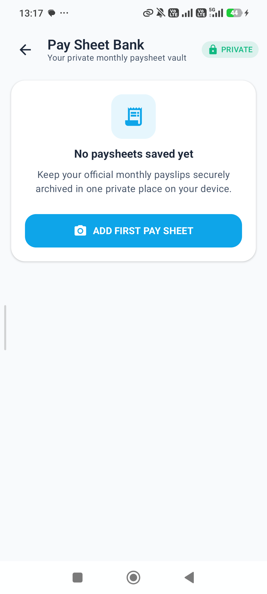 |
| 19 | `audit-output/full-ui-audit-2026-11-05/screenshots/05_more_scrolled.png` | `05_more_scrolled.png` | 182.5 KB | 2026-11-05 22:31:34 | Shows NursingOTApp UI (More Tools hub navigation) | 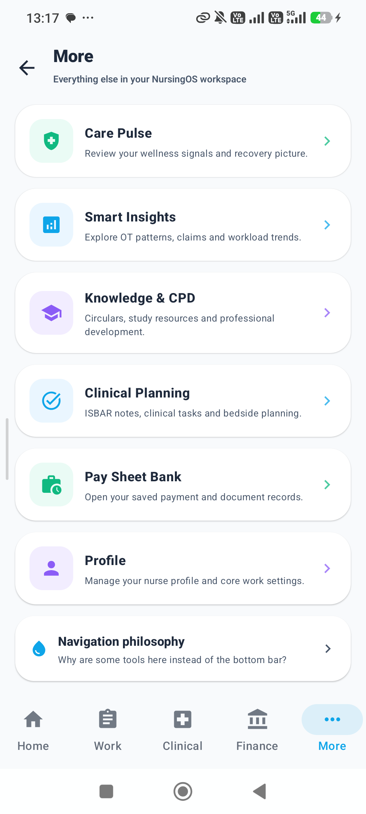 |
| 20 | `audit-output/full-ui-audit-2026-11-05/screenshots/06_final_return_home.png` | `06_final_return_home.png` | 188.7 KB | 2026-11-05 22:31:34 | Shows NursingOTApp UI (Home screen / hero / shift snapshot / guide dialog) |  |
| 21 | `audit-output/physical-device/screenshots/12_dismissed_dialog.png` | `12_dismissed_dialog.png` | 199.7 KB | 2026-11-06 02:46:36 | Shows NursingOTApp UI (Interactive dialog / confirmation modal) |  |
| 22 | `audit-output/physical-device/screenshots/13_discard_dialog.png` | `13_discard_dialog.png` | 327.7 KB | 2026-11-06 02:52:08 | Shows NursingOTApp UI (Interactive dialog / confirmation modal) | 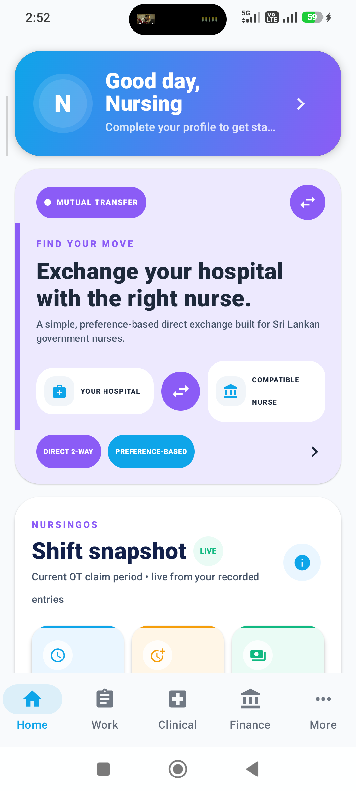 |
| 23 | `audit-output/physical-device/screenshots/B4A_clinical_planning_isbar_tab.png` | `B4A_clinical_planning_isbar_tab.png` | 119.1 KB | 2026-11-06 04:36:22 | Shows NursingOTApp UI (Clinical Tools / Calculators / Bedside Navigation) | 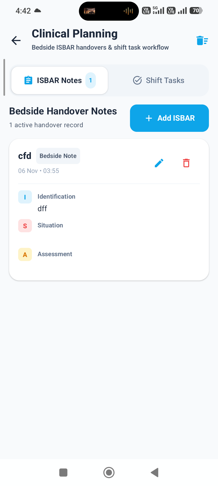 |
| 24 | `audit-output/physical-device/screenshots/B4A_clinical_planning_tasks_tab.png` | `B4A_clinical_planning_tasks_tab.png` | 138.4 KB | 2026-11-06 04:36:38 | Shows NursingOTApp UI (Clinical Tools / Calculators / Bedside Navigation) | 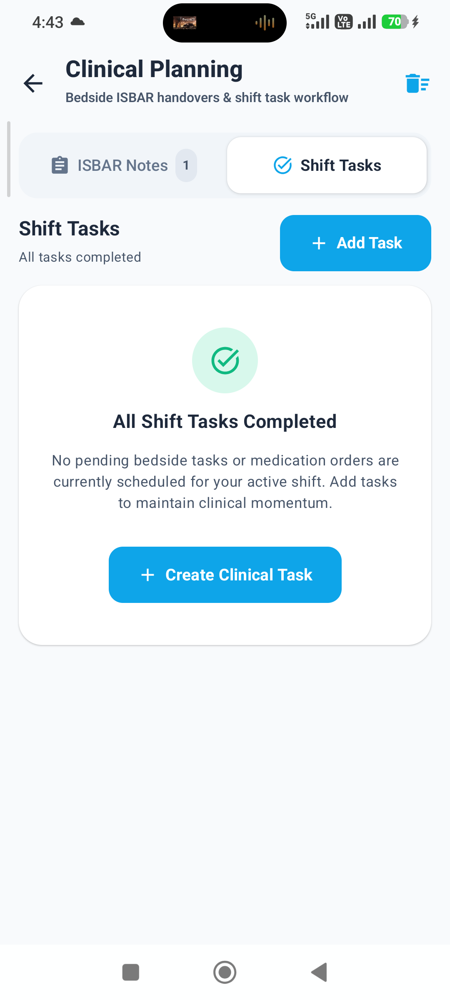 |
| 25 | `audit-output/physical-device/screenshots/B4B_ISBAR_01_created.png` | `B4B_ISBAR_01_created.png` | 191.9 KB | 2026-11-06 05:14:50 | Shows NursingOTApp UI (ISBAR clinical handoff communication) | 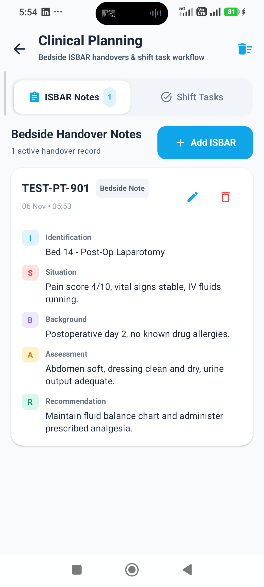 |
| 26 | `audit-output/physical-device/screenshots/B4B_ISBAR_02_edited.png` | `B4B_ISBAR_02_edited.png` | 199.2 KB | 2026-11-06 05:31:35 | Shows NursingOTApp UI (ISBAR clinical handoff communication) | 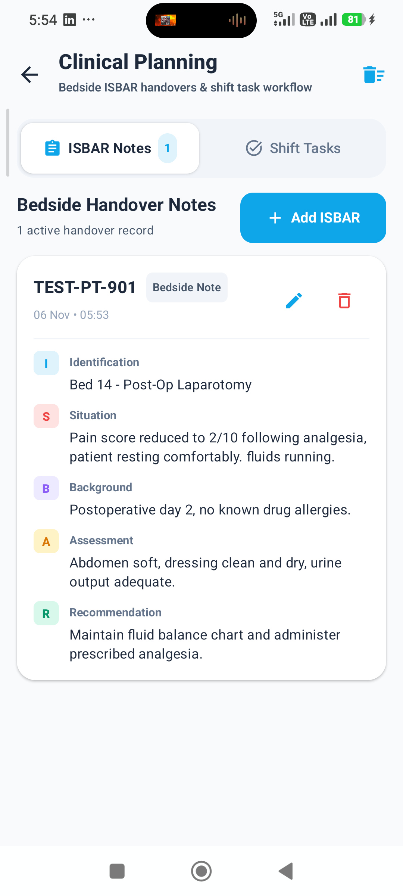 |
| 27 | `audit-output/physical-device/screenshots/B4B_ISBAR_03_delete_dialog.png` | `B4B_ISBAR_03_delete_dialog.png` | 168.0 KB | 2026-11-06 05:32:12 | Shows NursingOTApp UI (ISBAR clinical handoff communication) | 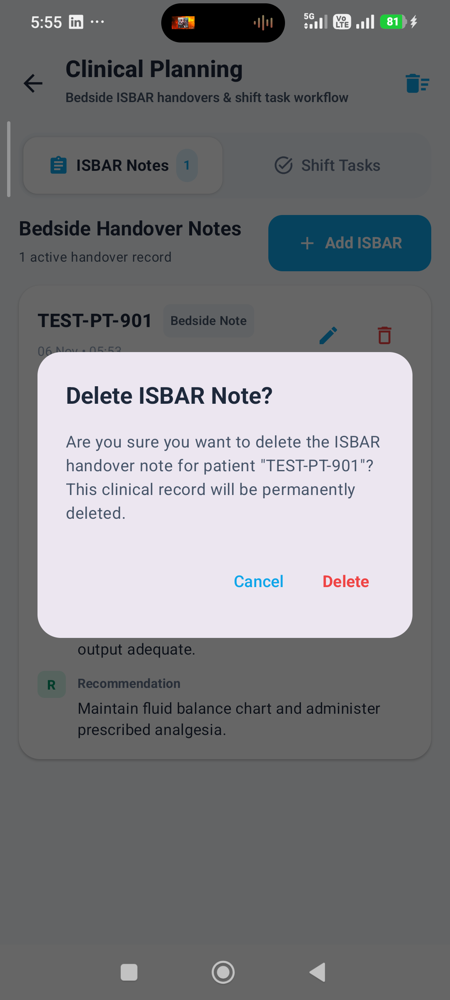 |
| 28 | `audit-output/physical-device/screenshots/B4B_ISBAR_04_delete_cancelled.png` | `B4B_ISBAR_04_delete_cancelled.png` | 198.8 KB | 2026-11-06 05:32:26 | Shows NursingOTApp UI (ISBAR clinical handoff communication) | 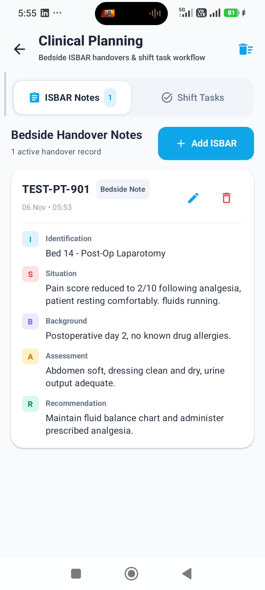 |
| 29 | `audit-output/physical-device/screenshots/B4B_ISBAR_05_deleted.png` | `B4B_ISBAR_05_deleted.png` | 145.3 KB | 2026-11-06 05:32:48 | Shows NursingOTApp UI (ISBAR clinical handoff communication) | 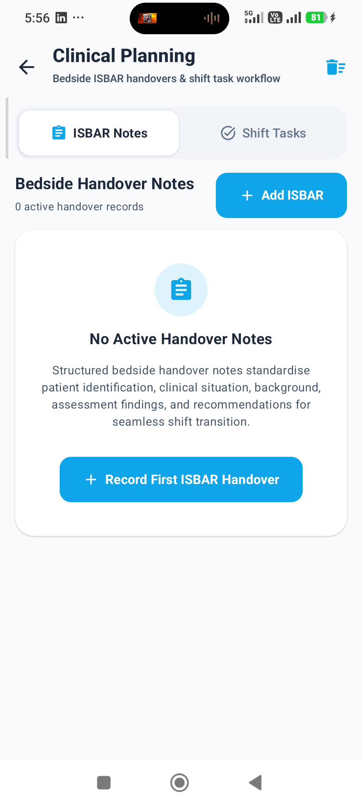 |
| 30 | `audit-output/physical-device/screenshots/B4B_TASK_01_created.png` | `B4B_TASK_01_created.png` | 147.2 KB | 2026-11-06 05:39:55 | Shows NursingOTApp UI (Clinical Tasks list & management) | 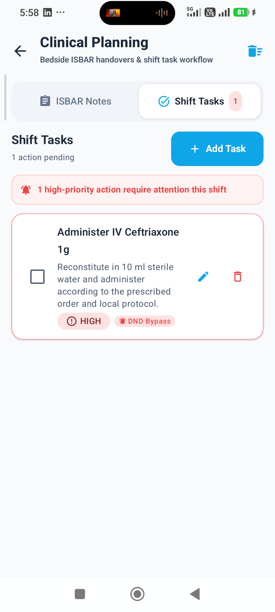 |
| 31 | `audit-output/physical-device/screenshots/B4B_TASK_02_completed.png` | `B4B_TASK_02_completed.png` | 136.3 KB | 2026-11-06 05:40:10 | Shows NursingOTApp UI (Clinical Tasks list & management) | 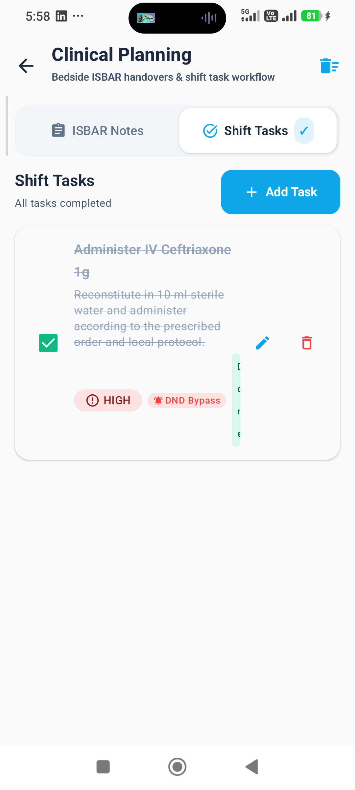 |
| 32 | `audit-output/physical-device/screenshots/B4B_TASK_03_edited.png` | `B4B_TASK_03_edited.png` | 143.3 KB | 2026-11-06 05:59:18 | Shows NursingOTApp UI (Clinical Tasks list & management) | 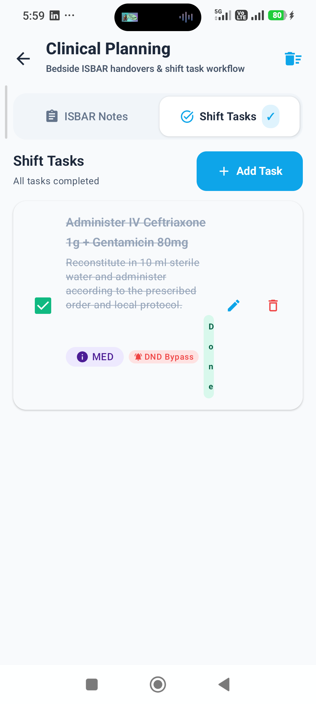 |
| 33 | `audit-output/physical-device/screenshots/B4B_TASK_04_delete_dialog.png` | `B4B_TASK_04_delete_dialog.png` | 151.1 KB | 2026-11-06 05:59:54 | Shows NursingOTApp UI (Clinical Tasks list & management) | 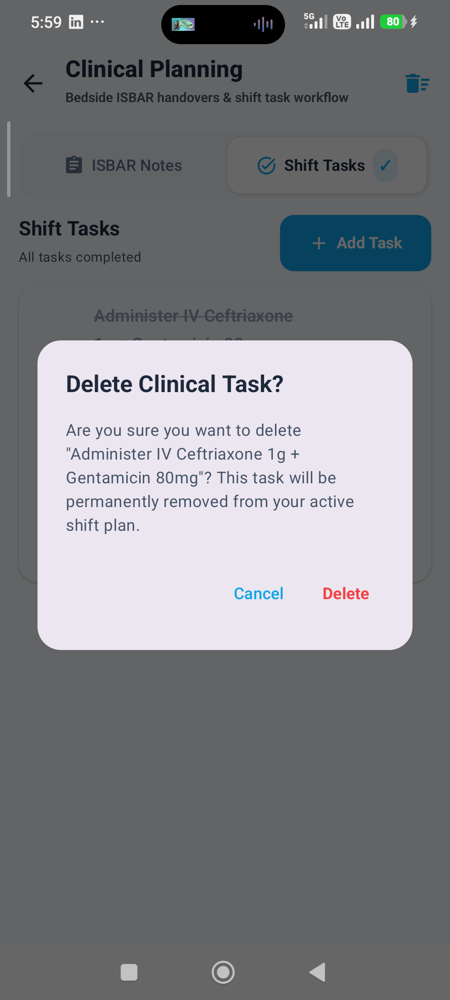 |
| 34 | `audit-output/physical-device/screenshots/B4B_TASK_05_delete_cancelled.png` | `B4B_TASK_05_delete_cancelled.png` | 143.3 KB | 2026-11-06 06:00:10 | Shows NursingOTApp UI (Clinical Tasks list & management) |  |
| 35 | `audit-output/physical-device/screenshots/B4B_TASK_06_deleted.png` | `B4B_TASK_06_deleted.png` | 137.5 KB | 2026-11-06 06:00:33 | Shows NursingOTApp UI (Clinical Tasks list & management) | 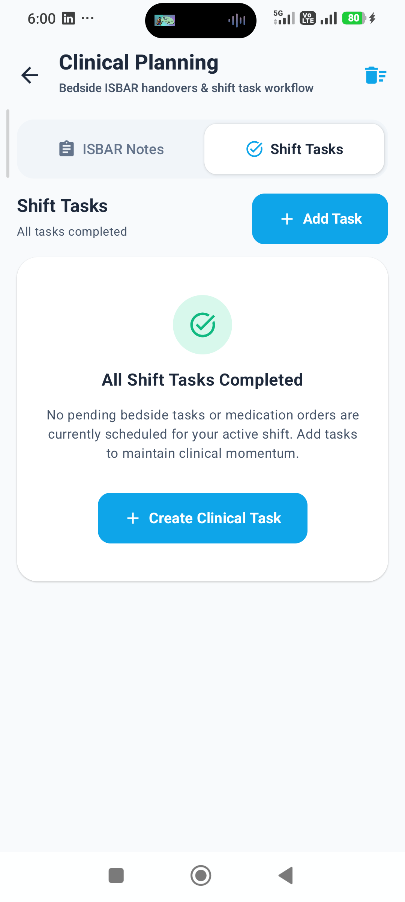 |
| 36 | `audit-output/physical-device/screenshots/B5_ISSUE-13_pdf_preview_final.png` | `B5_ISSUE-13_pdf_preview_final.png` | 439.1 KB | 2026-11-06 06:23:19 | Shows NursingOTApp UI (Official OT Claim PDF preview) | 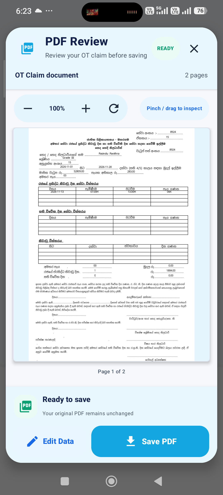 |
| 37 | `audit-output/physical-device/screenshots/B5_ISSUE-13_pdf_preview_modal.png` | `B5_ISSUE-13_pdf_preview_modal.png` | 243.7 KB | 2026-11-06 06:18:43 | Shows NursingOTApp UI (Official OT Claim PDF preview) | 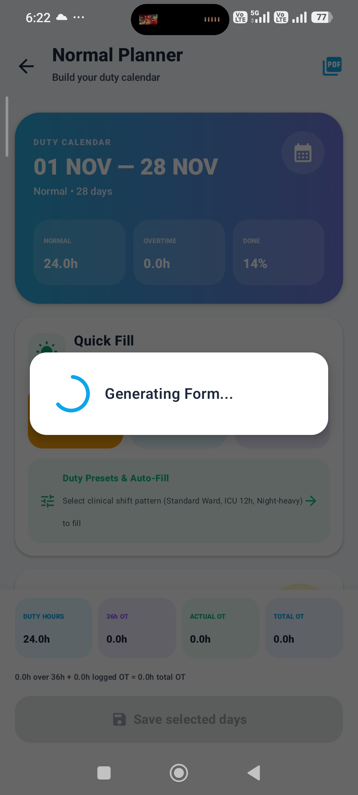 |
| 38 | `audit-output/physical-device/screenshots/ISSUE-01_finance_guide_dialog.png` | `ISSUE-01_finance_guide_dialog.png` | 189.5 KB | 2026-11-06 03:10:05 | Shows NursingOTApp UI (Advanced Finance Hub / Earnings / OT calculations) | 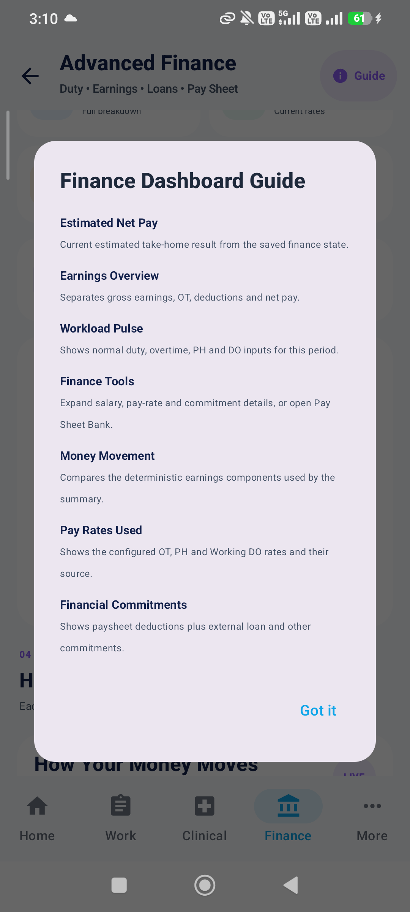 |
| 39 | `audit-output/physical-device/screenshots/ISSUE-01_finance_screen.png` | `ISSUE-01_finance_screen.png` | 178.6 KB | 2026-11-06 03:09:57 | Shows NursingOTApp UI (Advanced Finance Hub / Earnings / OT calculations) | 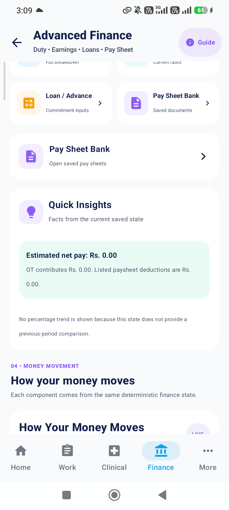 |
| 40 | `audit-output/physical-device/screenshots/ISSUE-02_smart_insights.png` | `ISSUE-02_smart_insights.png` | 369.3 KB | 2026-11-06 03:12:22 | Shows NursingOTApp UI (Smart Insights analytics) | 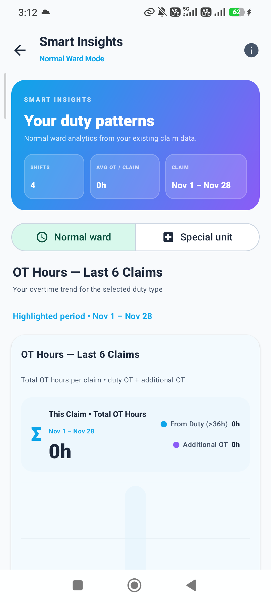 |
| 41 | `audit-output/physical-device/screenshots/ISSUE-03_financial_planning_card.png` | `ISSUE-03_financial_planning_card.png` | 194.7 KB | 2026-11-06 03:10:20 | Shows NursingOTApp UI (App UI verification screen) | 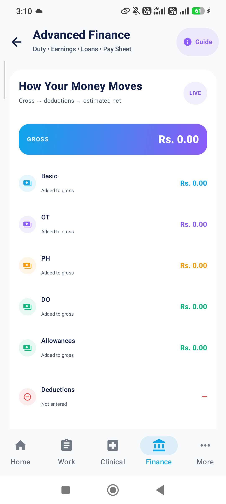 |
| 42 | `audit-output/physical-device/screenshots/ISSUE-04_calculator_cards.png` | `ISSUE-04_calculator_cards.png` | 216.9 KB | 2026-11-06 03:20:15 | Shows NursingOTApp UI (Clinical Tools / Calculators / Bedside Navigation) | 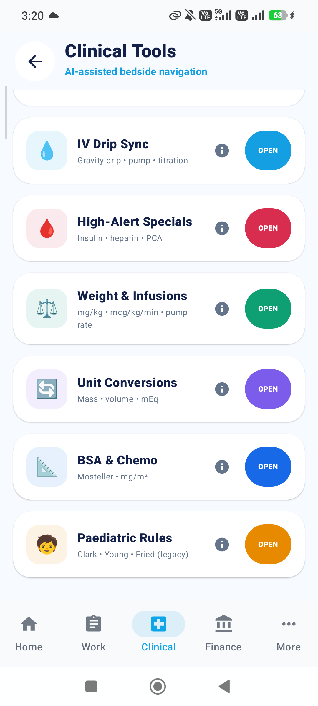 |
| 43 | `audit-output/physical-device/screenshots/ISSUE-04_clinical_cards_scrolled.png` | `ISSUE-04_clinical_cards_scrolled.png` | 497.5 KB | 2026-11-06 03:17:34 | Shows NursingOTApp UI (Clinical Tools / Calculators / Bedside Navigation) | 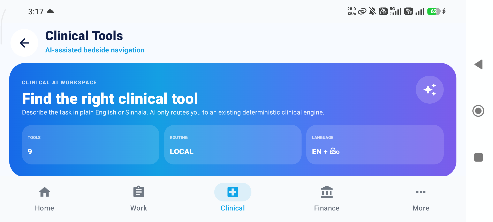 |
| 44 | `audit-output/physical-device/screenshots/ISSUE-04_clinical_tools.png` | `ISSUE-04_clinical_tools.png` | 512.0 KB | 2026-11-06 03:10:57 | Shows NursingOTApp UI (Clinical Tools / Calculators / Bedside Navigation) |  |
| 45 | `audit-output/physical-device/screenshots/ISSUE-05_calc_dialog.png` | `ISSUE-05_calc_dialog.png` | 272.1 KB | 2026-11-06 03:20:29 | Shows NursingOTApp UI (Clinical Tools / Calculators / Bedside Navigation) | 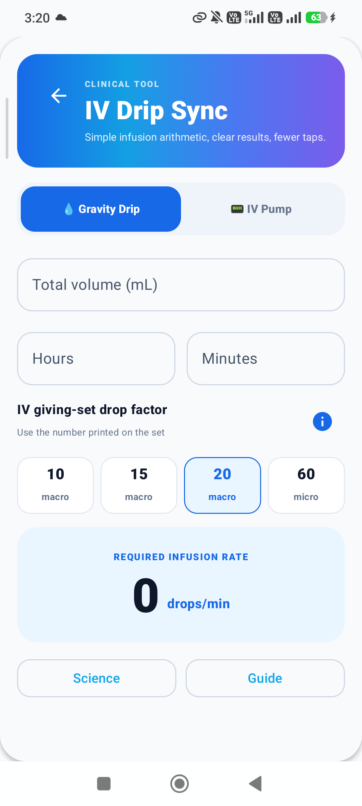 |
| 46 | `audit-output/physical-device/screenshots/ISSUE-05_calculator_detail.png` | `ISSUE-05_calculator_detail.png` | 512.0 KB | 2026-11-06 03:11:10 | Shows NursingOTApp UI (Clinical Tools / Calculators / Bedside Navigation) | 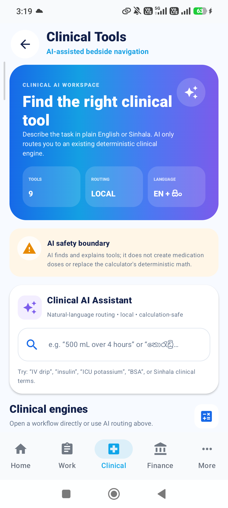 |
| 47 | `audit-output/physical-device/screenshots/ISSUE-06_clinical_planning_main.png` | `ISSUE-06_clinical_planning_main.png` | 222.9 KB | 2026-11-06 03:12:45 | Shows NursingOTApp UI (Clinical Tools / Calculators / Bedside Navigation) |  |
| 48 | `audit-output/physical-device/screenshots/ISSUE-06_workload_tab.png` | `ISSUE-06_workload_tab.png` | 222.4 KB | 2026-11-06 03:12:59 | Shows NursingOTApp UI (Work / OT & Claims / Planner / Duty Presets) |  |
| 49 | `audit-output/physical-device/screenshots/ISSUE-07_isbar_notes.png` | `ISSUE-07_isbar_notes.png` | 222.5 KB | 2026-11-06 03:13:13 | Shows NursingOTApp UI (ISBAR clinical handoff communication) | 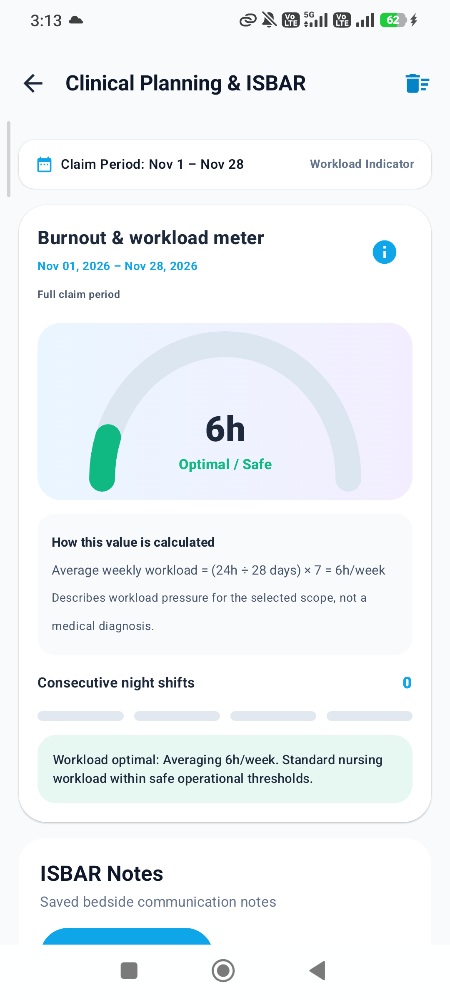 |
| 50 | `audit-output/physical-device/screenshots/ISSUE-08_clinical_tasks.png` | `ISSUE-08_clinical_tasks.png` | 222.4 KB | 2026-11-06 03:13:26 | Shows NursingOTApp UI (Clinical Tools / Calculators / Bedside Navigation) |  |
| 51 | `audit-output/physical-device/screenshots/ISSUE-09_paysheet_bank.png` | `ISSUE-09_paysheet_bank.png` | 96.2 KB | 2026-11-06 03:10:41 | Shows NursingOTApp UI (Pay Sheet Bank document vault) | 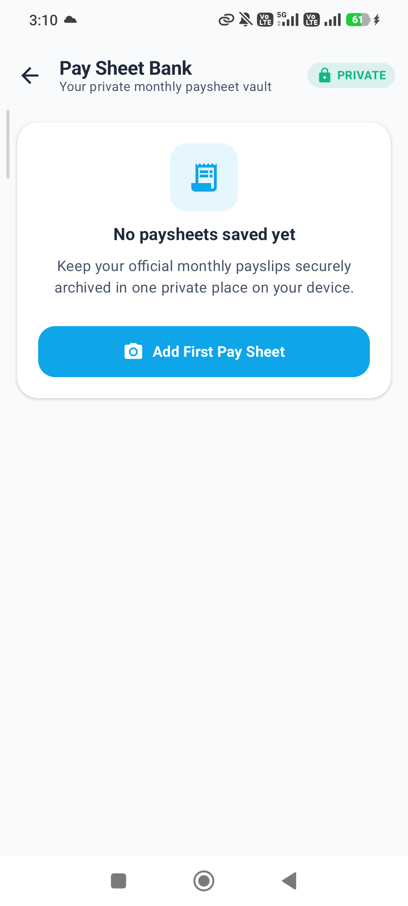 |
| 52 | `audit-output/physical-device/screenshots/ISSUE-10_command_center.png` | `ISSUE-10_command_center.png` | 392.8 KB | 2026-11-06 03:11:34 | Shows NursingOTApp UI (Nurse Command Center) | 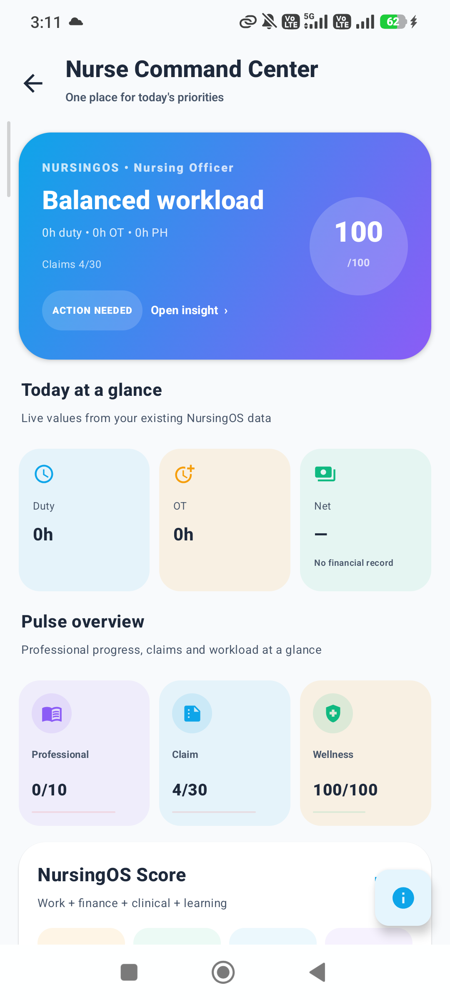 |
| 53 | `audit-output/physical-device/screenshots/ISSUE-11_care_pulse.png` | `ISSUE-11_care_pulse.png` | 438.5 KB | 2026-11-06 03:11:58 | Shows NursingOTApp UI (Care Pulse wellness monitoring) | 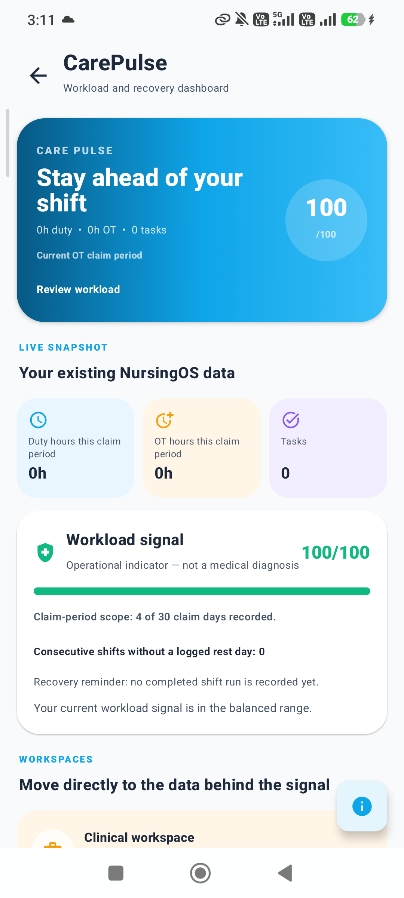 |
| 54 | `audit-output/physical-device/screenshots/ISSUE-12_discard_dialog.png` | `ISSUE-12_discard_dialog.png` | 250.4 KB | 2026-11-06 03:14:40 | Shows NursingOTApp UI (Interactive dialog / confirmation modal) | 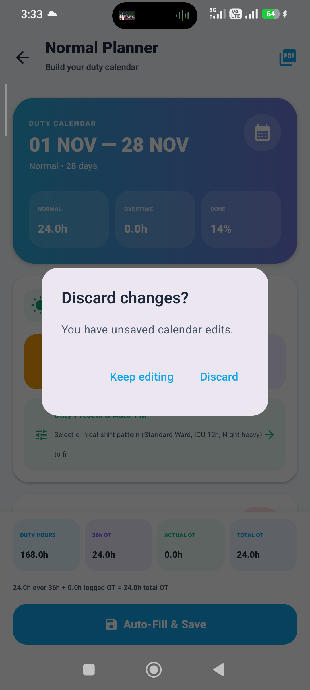 |
| 55 | `audit-output/physical-device/screenshots/ISSUE-12_discard_dialog_verified.png` | `ISSUE-12_discard_dialog_verified.png` | 186.0 KB | 2026-11-06 03:27:56 | Shows NursingOTApp UI (Interactive dialog / confirmation modal) |  |
| 56 | `audit-output/physical-device/screenshots/ISSUE-12_discarded_clean.png` | `ISSUE-12_discarded_clean.png` | 184.9 KB | 2026-11-06 03:14:48 | Shows NursingOTApp UI (Interactive dialog / confirmation modal) | 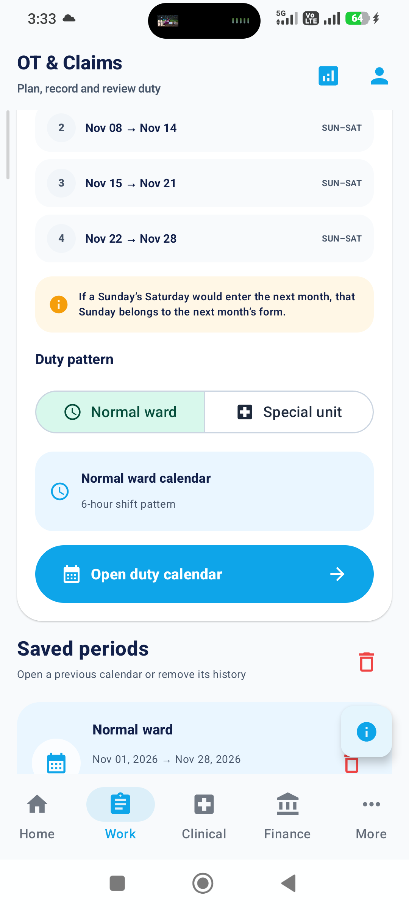 |
| 57 | `audit-output/physical-device/screenshots/ISSUE-12_normal_planner.png` | `ISSUE-12_normal_planner.png` | 341.1 KB | 2026-11-06 03:13:50 | Shows NursingOTApp UI (Work / OT & Claims / Planner / Duty Presets) |  |
| 58 | `audit-output/physical-device/screenshots/ISSUE-12_overwrite_confirmation.png` | `ISSUE-12_overwrite_confirmation.png` | 219.1 KB | 2026-11-06 03:31:14 | Shows NursingOTApp UI (App UI verification screen) | 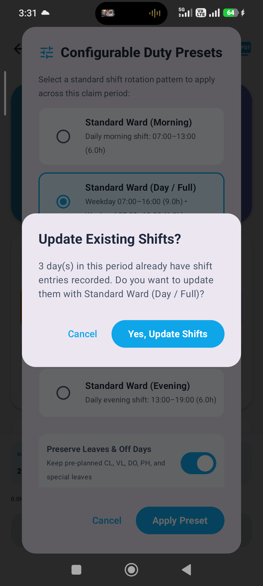 |
| 59 | `audit-output/physical-device/screenshots/ISSUE-12_planner_cards_visible.png` | `ISSUE-12_planner_cards_visible.png` | 230.7 KB | 2026-11-06 03:27:46 | Shows NursingOTApp UI (Work / OT & Claims / Planner / Duty Presets) | 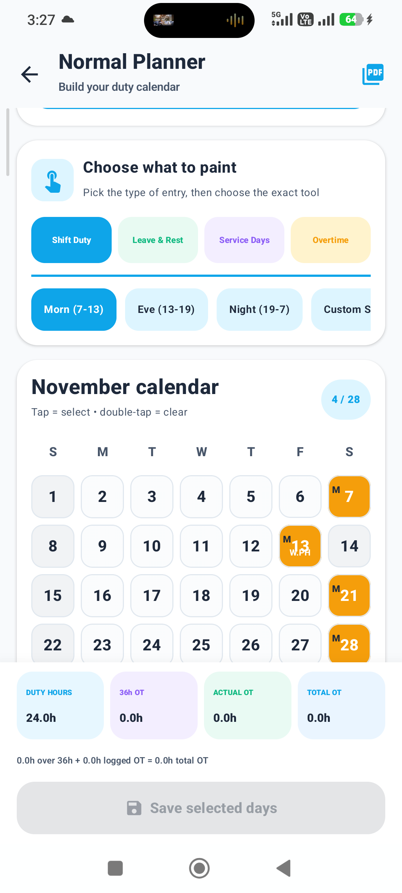 |
| 60 | `audit-output/physical-device/screenshots/ISSUE-12_preset_staged.png` | `ISSUE-12_preset_staged.png` | 344.2 KB | 2026-11-06 03:14:17 | Shows NursingOTApp UI (Work / OT & Claims / Planner / Duty Presets) | 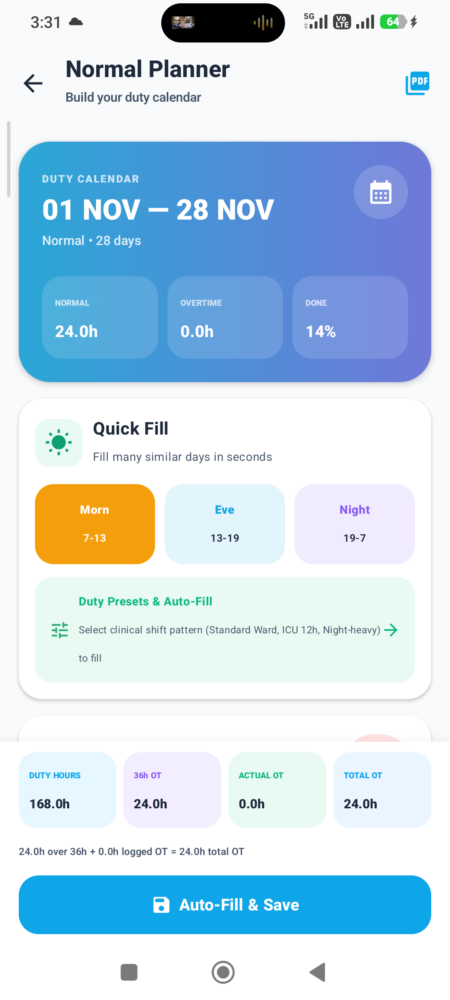 |
| 61 | `audit-output/physical-device/screenshots/ISSUE-12_preset_staged_verified.png` | `ISSUE-12_preset_staged_verified.png` | 229.4 KB | 2026-11-06 03:27:23 | Shows NursingOTApp UI (Work / OT & Claims / Planner / Duty Presets) | 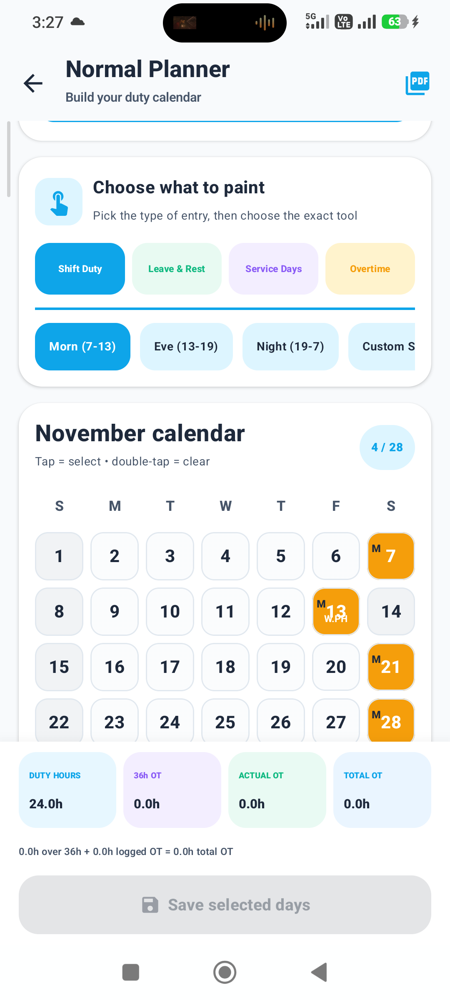 |
| 62 | `audit-output/physical-device/screenshots/ISSUE-12_presets_dialog.png` | `ISSUE-12_presets_dialog.png` | 247.2 KB | 2026-11-06 03:14:03 | Shows NursingOTApp UI (Work / OT & Claims / Planner / Duty Presets) | 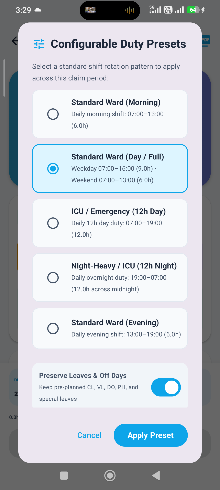 |
| 63 | `audit-output/physical-device/screenshots/ISSUE-12_presets_dialog_real.png` | `ISSUE-12_presets_dialog_real.png` | 186.5 KB | 2026-11-06 03:28:00 | Shows NursingOTApp UI (Work / OT & Claims / Planner / Duty Presets) | 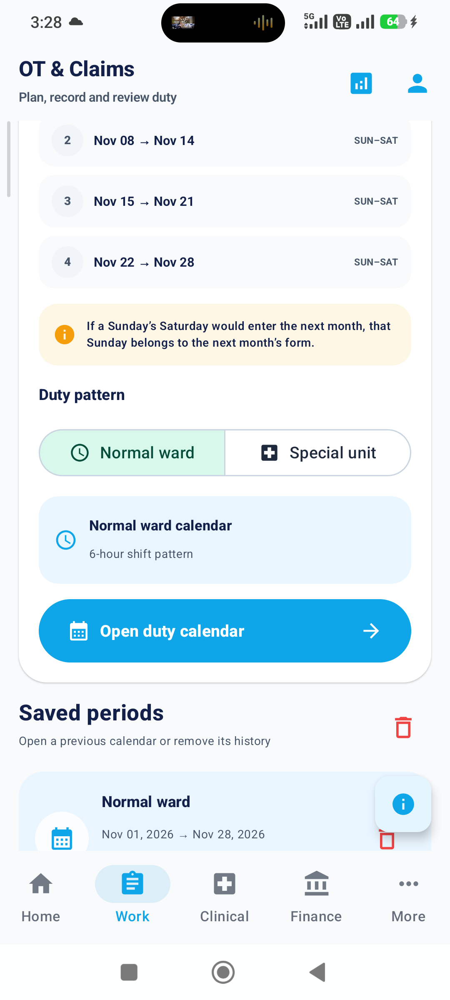 |
| 64 | `audit-output/physical-device/screenshots/ISSUE-12_presets_dialog_verified.png` | `ISSUE-12_presets_dialog_verified.png` | 229.4 KB | 2026-11-06 03:27:10 | Shows NursingOTApp UI (Work / OT & Claims / Planner / Duty Presets) |  |
| 65 | `audit-output/physical-device/screenshots/ISSUE-13_export_center_card.png` | `ISSUE-13_export_center_card.png` | 229.1 KB | 2026-11-06 03:34:49 | Shows NursingOTApp UI (App UI verification screen) |  |
| 66 | `audit-output/physical-device/screenshots/ISSUE-13_incomplete_calendar_dialog.png` | `ISSUE-13_incomplete_calendar_dialog.png` | 247.6 KB | 2026-11-06 03:15:08 | Shows NursingOTApp UI (Interactive dialog / confirmation modal) | 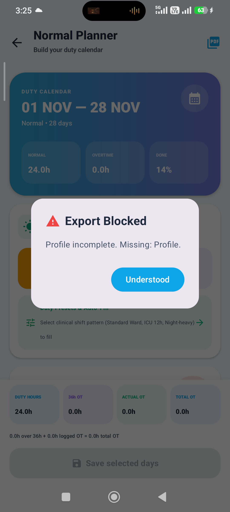 |
| 67 | `audit-output/physical-device/screenshots/ISSUE-13_incomplete_calendar_verified.png` | `ISSUE-13_incomplete_calendar_verified.png` | 248.9 KB | 2026-11-06 03:28:31 | Shows NursingOTApp UI (App UI verification screen) | 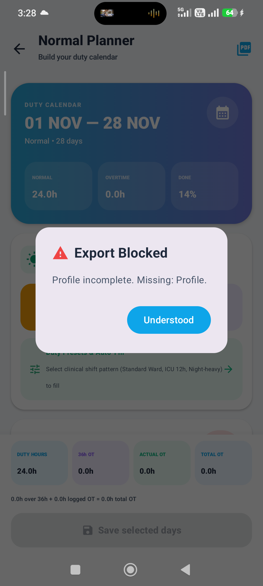 |
| 68 | `audit-output/physical-device/screenshots/ISSUE-13_unsaved_blocker.png` | `ISSUE-13_unsaved_blocker.png` | 256.0 KB | 2026-11-06 03:14:30 | Shows NursingOTApp UI (Interactive dialog / confirmation modal) | 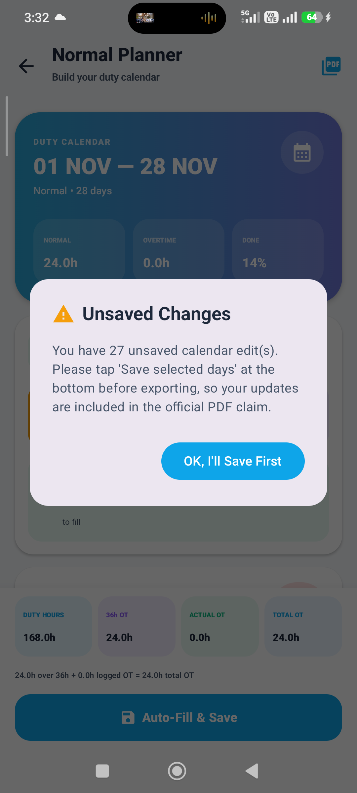 |
| 69 | `audit-output/physical-device/screenshots/ISSUE-13_unsaved_blocker_verified.png` | `ISSUE-13_unsaved_blocker_verified.png` | 201.6 KB | 2026-11-06 03:27:40 | Shows NursingOTApp UI (Interactive dialog / confirmation modal) | 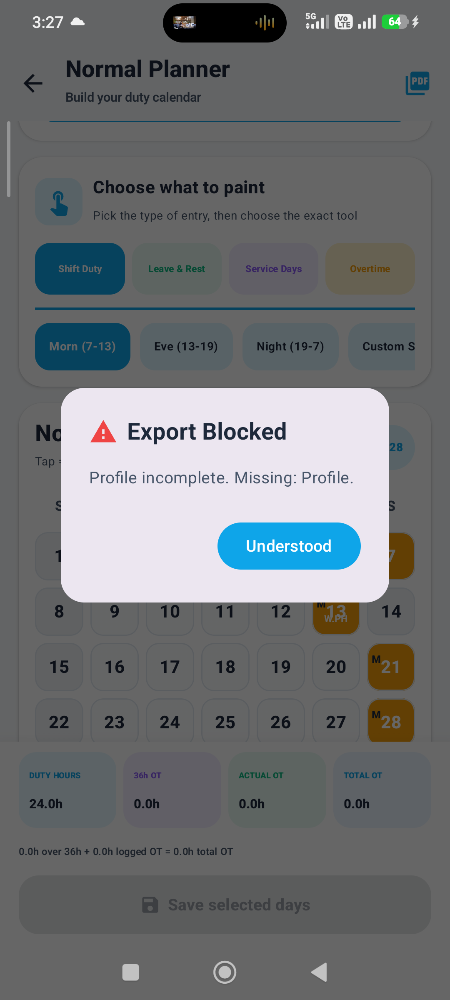 |
| 70 | `audit-output/physical-device/screenshots/ISSUE-14_home_subtitle.png` | `ISSUE-14_home_subtitle.png` | 325.0 KB | 2026-11-06 03:09:28 | Shows NursingOTApp UI (Home screen / hero / shift snapshot / guide dialog) | 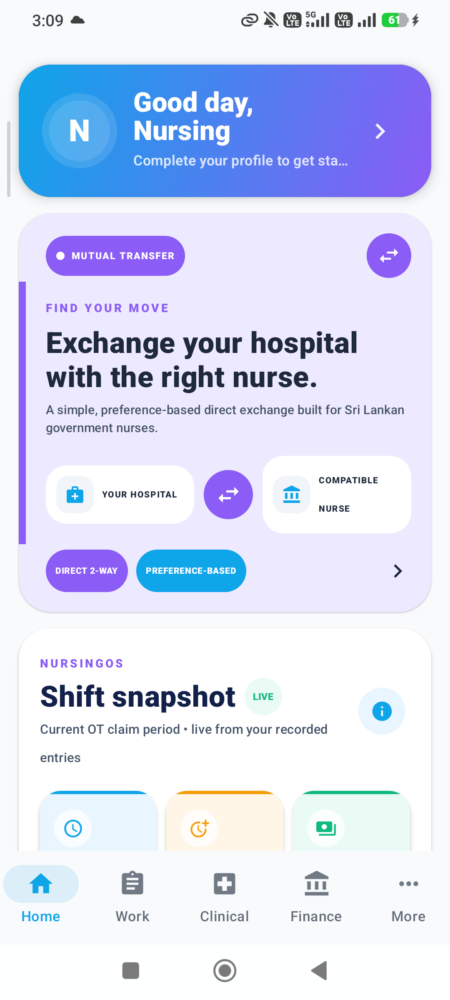 |
| 71 | `audit-output/physical-device/screenshots/ISSUE-15_profile_button.png` | `ISSUE-15_profile_button.png` | 325.0 KB | 2026-11-06 03:09:29 | Shows NursingOTApp UI (Nurse Profile / Settings) |  |
| 72 | `audit-output/physical-device/screenshots/ISSUE-16_guide_dialog.png` | `ISSUE-16_guide_dialog.png` | 272.4 KB | 2026-11-06 03:09:37 | Shows NursingOTApp UI (Interactive dialog / confirmation modal) |  |
| 73 | `audit-output/physical-device/screenshots/annotated_home.png` | `annotated_home.png` | 360.8 KB | 2026-11-06 02:05:02 | Shows NursingOTApp UI (Home screen / hero / shift snapshot / guide dialog) | 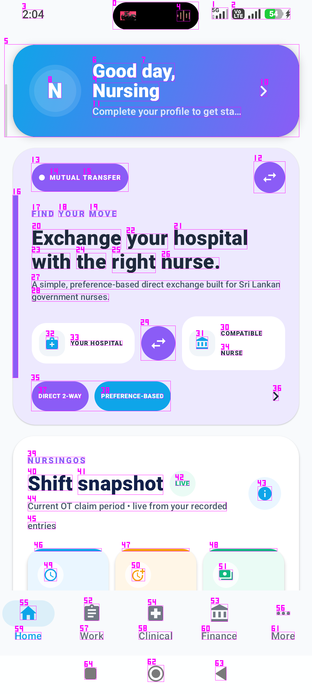 |
| 74 | `audit-output/physical-device/screenshots/b1_issue_14_home_subtitle.png` | `b1_issue_14_home_subtitle.png` | 324.9 KB | 2026-11-06 03:06:49 | Shows NursingOTApp UI (Home screen / hero / shift snapshot / guide dialog) |  |
| 75 | `audit-output/physical-device/screenshots/b1_issue_15_home_profile.png` | `b1_issue_15_home_profile.png` | 324.9 KB | 2026-11-06 03:06:50 | Shows NursingOTApp UI (Home screen / hero / shift snapshot / guide dialog) |  |
| 76 | `audit-output/physical-device/screenshots/b1_issue_16_guide_dialog.png` | `b1_issue_16_guide_dialog.png` | 272.0 KB | 2026-11-06 03:06:59 | Shows NursingOTApp UI (Interactive dialog / confirmation modal) | 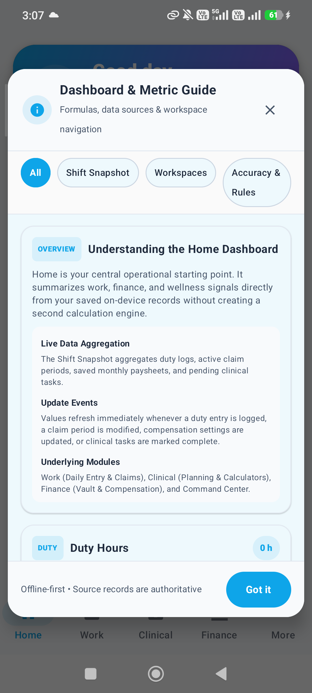 |
| 77 | `audit-output/physical-device/screenshots/b3_01_work_screen.png` | `b3_01_work_screen.png` | 353.0 KB | 2026-11-06 03:21:31 | Shows NursingOTApp UI (Work / OT & Claims / Planner / Duty Presets) |  |
| 78 | `audit-output/physical-device/screenshots/b3_02_normal_planner.png` | `b3_02_normal_planner.png` | 353.0 KB | 2026-11-06 03:21:45 | Shows NursingOTApp UI (Work / OT & Claims / Planner / Duty Presets) |  |
| 79 | `audit-output/physical-device/screenshots/current_state.png` | `current_state.png` | 199.8 KB | 2026-11-06 02:46:17 | Shows NursingOTApp UI (App UI verification screen) |  |
| 80 | `audit-output/physical-device/screenshots/diagnostic_01_initial.png` | `diagnostic_01_initial.png` | 324.4 KB | 2026-11-06 02:42:49 | Shows NursingOTApp UI (App UI verification screen) |  |
| 81 | `audit-output/physical-device/screenshots/diagnostic_02_finance_screen.png` | `diagnostic_02_finance_screen.png` | 177.9 KB | 2026-11-06 02:55:41 | Shows NursingOTApp UI (Advanced Finance Hub / Earnings / OT calculations) |  |
| 82 | `audit-output/physical-device/screenshots/diagnostic_03_returned_home.png` | `diagnostic_03_returned_home.png` | 324.8 KB | 2026-11-06 02:55:47 | Shows NursingOTApp UI (Home screen / hero / shift snapshot / guide dialog) |  |
| 83 | `audit-output/physical-device/screenshots/nav_clinical.png` | `nav_clinical.png` | 216.3 KB | 2026-11-06 03:04:21 | Shows NursingOTApp UI (Clinical Tools / Calculators / Bedside Navigation) |  |
| 84 | `audit-output/physical-device/screenshots/nav_home.png` | `nav_home.png` | 324.4 KB | 2026-11-06 03:03:53 | Shows NursingOTApp UI (Home screen / hero / shift snapshot / guide dialog) |  |
| 85 | `audit-output/physical-device/screenshots/nav_work.png` | `nav_work.png` | 352.9 KB | 2026-11-06 03:04:06 | Shows NursingOTApp UI (Work / OT & Claims / Planner / Duty Presets) |  |
| 86 | `audit-output/physical-device/screenshots/screen_clinical.png` | `screen_clinical.png` | 216.3 KB | 2026-11-06 03:04:46 | Shows NursingOTApp UI (Clinical Tools / Calculators / Bedside Navigation) |  |
| 87 | `audit-output/physical-device/screenshots/screen_more.png` | `screen_more.png` | 203.2 KB | 2026-11-06 03:05:42 | Shows NursingOTApp UI (More Tools hub navigation) |  |
| 88 | `audit-output/redmi-ui-audit-2026-11-05/01_home_guide_dialog.png` | `01_home_guide_dialog.png` | 253.7 KB | 2026-11-05 13:05:10 | Shows NursingOTApp UI (Home screen / hero / shift snapshot / guide dialog) |  |
| 89 | `audit-output/redmi-ui-audit-2026-11-05/01_home_initial.png` | `01_home_initial.png` | 277.8 KB | 2026-11-05 12:41:47 | Shows NursingOTApp UI (Home screen / hero / shift snapshot / guide dialog) |  |
| 90 | `audit-output/redmi-ui-audit-2026-11-05/01_home_scrolled.png` | `01_home_scrolled.png` | 189.0 KB | 2026-11-05 12:42:25 | Shows NursingOTApp UI (Home screen / hero / shift snapshot / guide dialog) |  |
| 91 | `audit-output/redmi-ui-audit-2026-11-05/02_work_initial.png` | `02_work_initial.png` | 303.7 KB | 2026-11-05 12:52:50 | Shows NursingOTApp UI (Work / OT & Claims / Planner / Duty Presets) |  |
| 92 | `audit-output/redmi-ui-audit-2026-11-05/02_work_scrolled.png` | `02_work_scrolled.png` | 161.2 KB | 2026-11-05 13:13:20 | Shows NursingOTApp UI (Work / OT & Claims / Planner / Duty Presets) |  |
| 93 | `audit-output/redmi-ui-audit-2026-11-05/03_clinical_initial.png` | `03_clinical_initial.png` | 404.5 KB | 2026-11-05 13:13:20 | Shows NursingOTApp UI (Clinical Tools / Calculators / Bedside Navigation) |  |
| 94 | `audit-output/redmi-ui-audit-2026-11-05/03_clinical_scrolled.png` | `03_clinical_scrolled.png` | 203.5 KB | 2026-11-05 13:13:20 | Shows NursingOTApp UI (Clinical Tools / Calculators / Bedside Navigation) |  |
| 95 | `audit-output/redmi-ui-audit-2026-11-05/04_finance_initial.png` | `04_finance_initial.png` | 464.6 KB | 2026-11-05 13:13:20 | Shows NursingOTApp UI (Advanced Finance Hub / Earnings / OT calculations) |  |
| 96 | `audit-output/redmi-ui-audit-2026-11-05/04_finance_scrolled.png` | `04_finance_scrolled.png` | 169.1 KB | 2026-11-05 13:13:20 | Shows NursingOTApp UI (Advanced Finance Hub / Earnings / OT calculations) |  |
| 97 | `audit-output/redmi-ui-audit-2026-11-05/05_more_article_reader.png` | `05_more_article_reader.png` | 224.6 KB | 2026-11-05 13:17:47 | Shows NursingOTApp UI (Knowledge Hub / Article Reader / Evidence Library) |  |
| 98 | `audit-output/redmi-ui-audit-2026-11-05/05_more_article_reader_scrolled.png` | `05_more_article_reader_scrolled.png` | 224.6 KB | 2026-11-05 13:17:47 | Shows NursingOTApp UI (Knowledge Hub / Article Reader / Evidence Library) |  |
| 99 | `audit-output/redmi-ui-audit-2026-11-05/05_more_clinical_planning.png` | `05_more_clinical_planning.png` | 183.3 KB | 2026-11-05 13:17:48 | Shows NursingOTApp UI (Clinical Tools / Calculators / Bedside Navigation) |  |
| 100 | `audit-output/redmi-ui-audit-2026-11-05/05_more_command_center.png` | `05_more_command_center.png` | 349.3 KB | 2026-11-05 13:17:48 | Shows NursingOTApp UI (Nurse Command Center) |  |
| 101 | `audit-output/redmi-ui-audit-2026-11-05/05_more_initial.png` | `05_more_initial.png` | 321.9 KB | 2026-11-05 13:13:20 | Shows NursingOTApp UI (More Tools hub navigation) |  |
| 102 | `audit-output/redmi-ui-audit-2026-11-05/05_more_knowledge_hub.png` | `05_more_knowledge_hub.png` | 473.0 KB | 2026-11-05 13:17:47 | Shows NursingOTApp UI (Knowledge Hub / Article Reader / Evidence Library) |  |
| 103 | `audit-output/redmi-ui-audit-2026-11-05/05_more_knowledge_hub_scrolled.png` | `05_more_knowledge_hub_scrolled.png` | 210.1 KB | 2026-11-05 13:17:47 | Shows NursingOTApp UI (Knowledge Hub / Article Reader / Evidence Library) |  |
| 104 | `audit-output/redmi-ui-audit-2026-11-05/05_more_pay_sheet_bank.png` | `05_more_pay_sheet_bank.png` | 85.0 KB | 2026-11-05 13:17:48 | Shows NursingOTApp UI (Pay Sheet Bank document vault) |  |
| 105 | `audit-output/redmi-ui-audit-2026-11-05/05_more_scrolled.png` | `05_more_scrolled.png` | 182.5 KB | 2026-11-05 13:13:20 | Shows NursingOTApp UI (More Tools hub navigation) |  |
| 106 | `audit-output/redmi-ui-audit-2026-11-05/06_final_return_home.png` | `06_final_return_home.png` | 188.7 KB | 2026-11-05 13:13:20 | Shows NursingOTApp UI (Home screen / hero / shift snapshot / guide dialog) |  |
| 107 | `audit-output/ui-003-evidence/ui003_01_library_overview.png` | `ui003_01_library_overview.png` | 489.4 KB | 2026-11-05 15:04:20 | Shows NursingOTApp UI (Knowledge Hub / Article Reader / Evidence Library) |  |
| 108 | `audit-output/ui-003-evidence/ui003_02_simulated_article_reader_top.png` | `ui003_02_simulated_article_reader_top.png` | 483.4 KB | 2026-11-05 15:04:20 | Shows NursingOTApp UI (Knowledge Hub / Article Reader / Evidence Library) |  |
| 109 | `audit-output/ui-003-evidence/ui003_04_card_badges_medication_safety.png` | `ui003_04_card_badges_medication_safety.png` | 483.5 KB | 2026-11-05 15:10:13 | Shows NursingOTApp UI (Knowledge Hub / Article Reader / Evidence Library) |  |
| 110 | `audit-output/ui-003-evidence/ui003_04_card_badges_ministry_circulars.png` | `ui003_04_card_badges_ministry_circulars.png` | 485.5 KB | 2026-11-05 15:04:20 | Shows NursingOTApp UI (Knowledge Hub / Article Reader / Evidence Library) |  |
| 111 | `audit-output/ui003_01_library_overview.png` | `ui003_01_library_overview.png` | 472.0 KB | 2026-11-05 14:49:18 | Shows NursingOTApp UI (Knowledge Hub / Article Reader / Evidence Library) |  |
| 112 | `audit-output/ui003_02_simulated_article_reader_top.png` | `ui003_02_simulated_article_reader_top.png` | 204.7 KB | 2026-11-05 14:40:28 | Shows NursingOTApp UI (Knowledge Hub / Article Reader / Evidence Library) |  |
