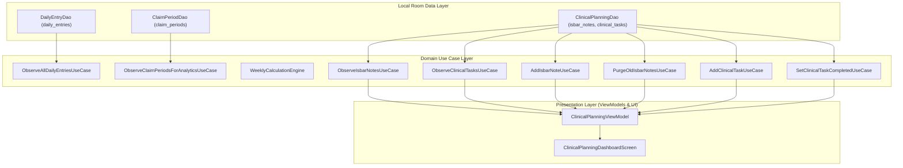

# NURSING SUPER APP — BATCH 2 READ-ONLY PREFLIGHT REPORT
## CLINICAL ENGINE & WORKLOAD REMEDIATION (ISSUE-06, ISSUE-07, ISSUE-08)

**Date:** November 6, 2026  
**Application:** NursingOTApp (`com.pasindu.nursingotapp`)  
**Workspace:** `C:\Users\Shaan\StudioProjects\NursingOTApp`  
**Execution Mode:** STRICTLY READ-ONLY PREFLIGHT AUDIT  
**Scope:** Architecture inspection, data flow analysis, Room migration risk evaluation, and safe implementation planning for Batch 2 issues.

---

## 1. Current Git Branch, HEAD & Working-Tree Status

- **Current Branch:** `fix/mutual-transfer-test-polling-regressions`
- **HEAD Commit:** `cb1d47b32cef8e0ab20d5054f76c1261321d6879`
- **Working Tree Summary:**
  - `50 modified files` (including Room database migration tests, Knowledge Hub KH-04 models, Mutual Transfer screens, and verified Batch 1 UI fixes).
  - `26 untracked files/directories` (schemas 13–17, assets, audit reports, seed data, and documentation).
  - All existing untracked and modified files remain 100% preserved. Zero git mutations performed.

---

## 2. Exact Relevant Source Files

### 2.1 Issue-06 (Burnout Meter Genuine Analytics Integration)
1. [`app/src/main/java/com/pasindu/nursingotapp/ui/components/BurnoutMeterCard.kt`](file:///C:/Users/Shaan/StudioProjects/NursingOTApp/app/src/main/java/com/pasindu/nursingotapp/ui/components/BurnoutMeterCard.kt)
   - Component expecting `startDate`, `endDate`, `avgWeeklyHours`, `consecutiveNightShifts`, `suggestionText`, `totalHours`, `periodDays`, `weeksEquivalent`.
2. [`app/src/main/java/com/pasindu/nursingotapp/ui/screens/ClinicalPlanningDashboardScreen.kt`](file:///C:/Users/Shaan/StudioProjects/NursingOTApp/app/src/main/java/com/pasindu/nursingotapp/ui/screens/ClinicalPlanningDashboardScreen.kt#L120-L130)
   - Current caller (lines 120–130) passing hardcoded `avgWeeklyHours = 0f, consecutiveNightShifts = 0, suggestionText = "Add duty information..."`.
3. [`app/src/main/java/com/pasindu/nursingotapp/ui/screens/AnalyticsScreen.kt`](file:///C:/Users/Shaan/StudioProjects/NursingOTApp/app/src/main/java/com/pasindu/nursingotapp/ui/screens/AnalyticsScreen.kt#L282-L340)
   - Canonical implementation of genuine shift calculation using `WeeklyCalculationEngine`.
4. [`app/src/main/java/com/pasindu/nursingotapp/domain/calculation/WeeklyCalculationEngine.kt`](file:///C:/Users/Shaan/StudioProjects/NursingOTApp/app/src/main/java/com/pasindu/nursingotapp/domain/calculation/WeeklyCalculationEngine.kt)
   - Deterministic engine methods: `calculateTotalHoursForCalendarPeriod()` and `calculateMaxConsecutiveNightShifts()`.
5. [`app/src/main/java/com/pasindu/nursingotapp/domain/usecase/AnalyticsUseCases.kt`](file:///C:/Users/Shaan/StudioProjects/NursingOTApp/app/src/main/java/com/pasindu/nursingotapp/domain/usecase/AnalyticsUseCases.kt)
   - `ObserveAllDailyEntriesUseCase` and `ObserveClaimPeriodsForAnalyticsUseCase`.
6. [`app/src/main/java/com/pasindu/nursingotapp/ui/ClinicalPlanningViewModel.kt`](file:///C:/Users/Shaan/StudioProjects/NursingOTApp/app/src/main/java/com/pasindu/nursingotapp/ui/ClinicalPlanningViewModel.kt)
   - Target ViewModel to expose live burnout state to `ClinicalPlanningDashboardScreen`.

### 2.2 Issue-07 (ISBAR Editing & Deletion)
1. [`app/src/main/java/com/pasindu/nursingotapp/data/local/entity/IsbarNoteEntity.kt`](file:///C:/Users/Shaan/StudioProjects/NursingOTApp/app/src/main/java/com/pasindu/nursingotapp/data/local/entity/IsbarNoteEntity.kt)
   - Entity definition with primary key `@PrimaryKey(autoGenerate = true) val id: Int = 0`.
2. [`app/src/main/java/com/pasindu/nursingotapp/data/local/dao/ClinicalPlanningDao.kt`](file:///C:/Users/Shaan/StudioProjects/NursingOTApp/app/src/main/java/com/pasindu/nursingotapp/data/local/dao/ClinicalPlanningDao.kt#L13-L22)
   - Missing individual `deleteIsbarNote` and `updateIsbarNote` operations.
3. [`app/src/main/java/com/pasindu/nursingotapp/domain/usecase/ClinicalPlanningUseCases.kt`](file:///C:/Users/Shaan/StudioProjects/NursingOTApp/app/src/main/java/com/pasindu/nursingotapp/domain/usecase/ClinicalPlanningUseCases.kt#L20-L56)
   - Missing domain use cases for updating and deleting individual ISBAR notes.
4. [`app/src/main/java/com/pasindu/nursingotapp/ui/ClinicalPlanningViewModel.kt`](file:///C:/Users/Shaan/StudioProjects/NursingOTApp/app/src/main/java/com/pasindu/nursingotapp/ui/ClinicalPlanningViewModel.kt#L45-L97)
   - Missing edit/delete methods.
5. [`app/src/main/java/com/pasindu/nursingotapp/ui/screens/ClinicalPlanningDashboardScreen.kt`](file:///C:/Users/Shaan/StudioProjects/NursingOTApp/app/src/main/java/com/pasindu/nursingotapp/ui/screens/ClinicalPlanningDashboardScreen.kt#L146-L156)
   - `isbarNotes.forEach` renders read-only text cards with zero edit/delete controls or dialog triggers.

### 2.3 Issue-08 (Clinical Tasks Editing & Deletion)
1. [`app/src/main/java/com/pasindu/nursingotapp/data/local/entity/ClinicalTaskEntity.kt`](file:///C:/Users/Shaan/StudioProjects/NursingOTApp/app/src/main/java/com/pasindu/nursingotapp/data/local/entity/ClinicalTaskEntity.kt)
   - Entity definition with primary key `@PrimaryKey(autoGenerate = true) val id: Int = 0`.
2. [`app/src/main/java/com/pasindu/nursingotapp/data/local/dao/ClinicalPlanningDao.kt`](file:///C:/Users/Shaan/StudioProjects/NursingOTApp/app/src/main/java/com/pasindu/nursingotapp/data/local/dao/ClinicalPlanningDao.kt#L23-L32)
   - Currently only has `insertTask()`, `getAllTasks()`, and `setTaskCompleted()`. Missing `deleteTask()` and `updateTask()`.
3. [`app/src/main/java/com/pasindu/nursingotapp/domain/usecase/ClinicalPlanningUseCases.kt`](file:///C:/Users/Shaan/StudioProjects/NursingOTApp/app/src/main/java/com/pasindu/nursingotapp/domain/usecase/ClinicalPlanningUseCases.kt#L58-L88)
   - Missing domain use cases for updating and deleting clinical tasks.
4. [`app/src/main/java/com/pasindu/nursingotapp/ui/ClinicalPlanningViewModel.kt`](file:///C:/Users/Shaan/StudioProjects/NursingOTApp/app/src/main/java/com/pasindu/nursingotapp/ui/ClinicalPlanningViewModel.kt#L99-L148)
   - Missing edit/delete task methods.
5. [`app/src/main/java/com/pasindu/nursingotapp/ui/screens/ClinicalPlanningDashboardScreen.kt`](file:///C:/Users/Shaan/StudioProjects/NursingOTApp/app/src/main/java/com/pasindu/nursingotapp/ui/screens/ClinicalPlanningDashboardScreen.kt#L172-L236)
   - `tasks.forEach` renders `ListItem` with checkbox only; lacks edit/delete icon buttons and confirmation dialogs.

---

## 3. Existing Architecture and Data Flow



### Data Flow Deficiencies Identified
1. **ClinicalPlanningViewModel Isolation from Workload Data:**
   `ClinicalPlanningViewModel` only receives clinical planning use cases. It does not observe `DailyEntryDao` or `ClaimPeriodDao`. As a result, `ClinicalPlanningDashboardScreen` had no bridge to duty records and defaulted to dummy zero values for the `BurnoutMeterCard`.
2. **One-Way Write Operations in Clinical Planning:**
   The DAO and use cases only support adding records (`insertIsbarNote`, `insertTask`) and toggling completion (`setTaskCompleted`). Neither update nor deletion APIs exist in the domain layer.

---

## 4. Current ISBAR Auto-Purge Behavior

### Detailed Inspection of Purge Implementation
- In [`PurgeOldIsbarNotesUseCase.kt`](file:///C:/Users/Shaan/StudioProjects/NursingOTApp/app/src/main/java/com/pasindu/nursingotapp/domain/usecase/ClinicalPlanningUseCases.kt#L46-L56):
  ```kotlin
  class PurgeOldIsbarNotesUseCase(private val dao: ClinicalPlanningDao) {
      companion object {
          const val RETENTION_HOURS = 48L
          const val MILLIS_PER_HOUR = 60L * 60L * 1000L
      }
      suspend operator fun invoke(nowMillis: Long = System.currentTimeMillis()) {
          val cutoff = nowMillis - (RETENTION_HOURS * MILLIS_PER_HOUR)
          dao.deleteOldNotes(cutoff)
      }
  }
  ```
- In [`ClinicalPlanningDao.kt:20-21`](file:///C:/Users/Shaan/StudioProjects/NursingOTApp/app/src/main/java/com/pasindu/nursingotapp/data/local/dao/ClinicalPlanningDao.kt#L20-L21):
  ```kotlin
  @Query("DELETE FROM isbar_notes WHERE timestamp < :cutoffTime")
  suspend fun deleteOldNotes(cutoffTime: Long)
  ```
- In [`ClinicalPlanningDashboardScreen.kt:94-100`](file:///C:/Users/Shaan/StudioProjects/NursingOTApp/app/src/main/java/com/pasindu/nursingotapp/ui/screens/ClinicalPlanningDashboardScreen.kt#L94-L100):
  ```kotlin
  actions = {
      IconButton(onClick = { viewModel.purgeOldIsbarNotes() }) {
          Icon(Icons.Default.DeleteSweep, contentDescription = "Purge >48h Notes", tint = Color(0xFF0284C7))
      }
  }
  ```
- **Finding:**
  The 48-hour purge logic is strictly mathematically correct (retention threshold = 48 hours), but it is **only executed on demand** when the user taps the `DeleteSweep` icon in the TopAppBar. It does **not** execute automatically in `init {}` of `ClinicalPlanningViewModel`.
  - Calling `purgeOldIsbarNotes()` in `init {}` of `ClinicalPlanningViewModel` ensures genuine automatic purging upon entering the clinical planning workspace, while retaining the manual sweep button for user control.

---

## 5. Existing Task Completion Behavior

- In [`ClinicalPlanningDashboardScreen.kt:227-234`](file:///C:/Users/Shaan/StudioProjects/NursingOTApp/app/src/main/java/com/pasindu/nursingotapp/ui/screens/ClinicalPlanningDashboardScreen.kt#L227-L234):
  - Checkbox toggles `viewModel.setTaskCompleted(task.id, isChecked)`.
- In [`SetClinicalTaskCompletedUseCase.kt:83-88`](file:///C:/Users/Shaan/StudioProjects/NursingOTApp/app/src/main/java/com/pasindu/nursingotapp/domain/usecase/ClinicalPlanningUseCases.kt#L83-L88):
  - Validates `require(taskId > 0)`.
  - Executes `dao.setTaskCompleted(taskId, completed)` via `@Query("UPDATE clinical_tasks SET isCompleted = :completed WHERE id = :taskId")`.
- In [`NurseCommandCenterViewModel.kt:84-99`](file:///C:/Users/Shaan/StudioProjects/NursingOTApp/app/src/main/java/com/pasindu/nursingotapp/ui/NurseCommandCenterViewModel.kt#L84-L99):
  - `completeClinicalTask` sets `isCompleted = true` and exposes an `undoLastCompletion()` flow via a snackbar/toast message.
- **Finding:**
  Task completion toggle works cleanly through Room Flow. However, tasks can never be edited (e.g. changing description, priority, or DND bypass) or removed once completed, cluttering the clinical workspace indefinitely.

---

## 6. Safe Implementation Proposal for Each Issue

### 6.1 ISSUE-06: Burnout Meter Genuine Analytics Integration
1. **Proposal:**
   - Define a domain use case `ObserveShiftAnalyticsUseCase(dailyEntryDao, claimPeriodDao)` (or inject existing `ObserveAllDailyEntriesUseCase` and `ObserveClaimPeriodsForAnalyticsUseCase` into `ClinicalPlanningViewModel`).
   - In `ClinicalPlanningViewModel`, compute a `StateFlow<BurnoutMetrics>` derived from `allEntries` and the active claim period (or rolling 7/14/30-day window) using the existing validated `WeeklyCalculationEngine.calculateTotalHoursForCalendarPeriod()` and `calculateMaxConsecutiveNightShifts()`.
   - Update `ClinicalPlanningDashboardScreen`: Replace static `avgWeeklyHours = 0f` with `burnoutMetrics.avgWeeklyHours`, `burnoutMetrics.consecutiveNightShifts`, `burnoutMetrics.suggestionText`, `burnoutMetrics.totalHours`, and `burnoutMetrics.periodDays`.
2. **Safety Proof:**
   - Uses existing `WeeklyCalculationEngine` without altering any OT or financial math.
   - Read-only data consumption; zero Room database writes.

### 6.2 ISSUE-07: ISBAR Editing & Deletion
1. **Proposal:**
   - **DAO:** Add `@Delete suspend fun deleteIsbarNote(note: IsbarNoteEntity)` and `@Update suspend fun updateIsbarNote(note: IsbarNoteEntity)` to `ClinicalPlanningDao`.
   - **Domain:** Add `DeleteIsbarNoteUseCase` and `UpdateIsbarNoteUseCase` to `ClinicalPlanningUseCases.kt`, provided in `ClinicalPlanningUseCaseModule`.
   - **ViewModel:** Add `deleteIsbarNote(note: IsbarNoteEntity)` and `updateIsbarNote(note: IsbarNoteEntity)` to `ClinicalPlanningViewModel`.
   - **UI:**
     - In `isbarNotes.forEach`, add an overflow menu or trailing action icons: Edit (`Icons.Default.Edit`) and Delete (`Icons.Default.DeleteOutline`).
     - Tapping Edit populates `IsbarFormCoordinator` in edit mode (`editingNote = note`) and opens the edit dialog.
     - Tapping Delete opens a confirmation dialog: *"Delete ISBAR note for patient [ID]?"*. Upon confirmation, calls `viewModel.deleteIsbarNote(note)`.
2. **Safety Proof:**
   - Uses the existing `@PrimaryKey val id: Int` on `IsbarNoteEntity`.
   - Requires user confirmation before deletion.

### 6.3 ISSUE-08: Clinical Tasks Editing & Deletion
1. **Proposal:**
   - **DAO:** Add `@Delete suspend fun deleteTask(task: ClinicalTaskEntity)` and `@Update suspend fun updateTask(task: ClinicalTaskEntity)` to `ClinicalPlanningDao`.
   - **Domain:** Add `DeleteClinicalTaskUseCase` and `UpdateClinicalTaskUseCase` to `ClinicalPlanningUseCases.kt`, provided in `ClinicalPlanningUseCaseModule`.
   - **ViewModel:** Add `deleteTask(task: ClinicalTaskEntity)` and `updateTask(task: ClinicalTaskEntity)` to `ClinicalPlanningViewModel`.
   - **UI:**
     - In `tasks.forEach`, add trailing action buttons to `ListItem`: Edit (`Icons.Default.Edit`) and Delete (`Icons.Default.DeleteOutline`).
     - Tapping Edit populates `ClinicalTaskFormCoordinator` in edit mode (`editingTask = task`) and opens the task dialog.
     - Tapping Delete opens a confirmation dialog: *"Delete clinical task '[taskName]'?"*. Upon confirmation, calls `viewModel.deleteTask(task)`.
2. **Safety Proof:**
   - Uses the existing `@PrimaryKey val id: Int` on `ClinicalTaskEntity`.
   - Requires user confirmation before deletion.

---

## 7. Room Migration Risks

- **Entity Inspection:**
  - `IsbarNoteEntity` already has `@PrimaryKey(autoGenerate = true) val id: Int = 0`.
  - `ClinicalTaskEntity` already has `@PrimaryKey(autoGenerate = true) val id: Int = 0`.
- **Schema Modification:** **NONE.**
  - Adding `@Delete` and `@Update` methods to `ClinicalPlanningDao` requires **zero table or column schema changes**.
  - Room database version **remains at 17** (or current version).
  - **Migration Risk: ZERO.** No Room migration files, JSON schema exports, or hash updates are required.

---

## 8. Existing Tests & Missing Test Coverage

### Existing Tests
- [`ClinicalPlanningUseCasesTest.kt`](file:///C:/Users/Shaan/StudioProjects/NursingOTApp/app/src/test/java/com/pasindu/nursingotapp/domain/usecase/ClinicalPlanningUseCasesTest.kt): Tests adding ISBAR note, trimming, blank validation, adding tasks, 48h purge calculation, and task completion.
- [`IsbarRequiredFieldValidationTest.kt`](file:///C:/Users/Shaan/StudioProjects/NursingOTApp/app/src/test/java/com/pasindu/nursingotapp/ui/screens/IsbarRequiredFieldValidationTest.kt): Tests form validation logic in `IsbarFormCoordinator`.
- [`ClinicalTaskFormValidationTest.kt`](file:///C:/Users/Shaan/StudioProjects/NursingOTApp/app/src/test/java/com/pasindu/nursingotapp/ui/screens/ClinicalTaskFormValidationTest.kt): Tests form validation logic in `ClinicalTaskFormCoordinator`.

### Missing Test Coverage to Add in Batch 2
1. `UpdateIsbarNoteUseCaseTest`: Verify updating an existing note preserves ID and updates fields.
2. `DeleteIsbarNoteUseCaseTest`: Verify deleting a note delegates to DAO.
3. `UpdateClinicalTaskUseCaseTest`: Verify updating task priority, bypassDnd, and description.
4. `DeleteClinicalTaskUseCaseTest`: Verify deleting task delegates to DAO.
5. `ClinicalPlanningShiftAnalyticsTest`: Verify `BurnoutMetrics` calculation from real shift entries.
6. Form coordinator edit-mode tests (loading existing values into draft state).

---

## 9. Files That Would Need Modification

1. [`app/src/main/java/com/pasindu/nursingotapp/data/local/dao/ClinicalPlanningDao.kt`](file:///C:/Users/Shaan/StudioProjects/NursingOTApp/app/src/main/java/com/pasindu/nursingotapp/data/local/dao/ClinicalPlanningDao.kt)
   - Add `@Delete` and `@Update` methods for `IsbarNoteEntity` and `ClinicalTaskEntity`.
2. [`app/src/main/java/com/pasindu/nursingotapp/domain/usecase/ClinicalPlanningUseCases.kt`](file:///C:/Users/Shaan/StudioProjects/NursingOTApp/app/src/main/java/com/pasindu/nursingotapp/domain/usecase/ClinicalPlanningUseCases.kt)
   - Add `UpdateIsbarNoteUseCase`, `DeleteIsbarNoteUseCase`, `UpdateClinicalTaskUseCase`, `DeleteClinicalTaskUseCase`, and `ObserveShiftAnalyticsUseCase`.
3. [`app/src/main/java/com/pasindu/nursingotapp/di/ClinicalPlanningUseCaseModule.kt`](file:///C:/Users/Shaan/StudioProjects/NursingOTApp/app/src/main/java/com/pasindu/nursingotapp/di/ClinicalPlanningUseCaseModule.kt)
   - Provide the new use cases to Hilt.
4. [`app/src/main/java/com/pasindu/nursingotapp/ui/ClinicalPlanningViewModel.kt`](file:///C:/Users/Shaan/StudioProjects/NursingOTApp/app/src/main/java/com/pasindu/nursingotapp/ui/ClinicalPlanningViewModel.kt)
   - Inject new use cases, expose `burnoutMetrics` StateFlow, add edit/delete functions, trigger auto-purge on `init`.
5. [`app/src/main/java/com/pasindu/nursingotapp/ui/screens/ClinicalPlanningDashboardScreen.kt`](file:///C:/Users/Shaan/StudioProjects/NursingOTApp/app/src/main/java/com/pasindu/nursingotapp/ui/screens/ClinicalPlanningDashboardScreen.kt)
   - Wire `BurnoutMeterCard` to `burnoutMetrics`.
   - Add edit/delete buttons and confirmation dialogs to ISBAR notes and clinical tasks.
6. [`app/src/test/java/com/pasindu/nursingotapp/domain/usecase/ClinicalPlanningUseCasesTest.kt`](file:///C:/Users/Shaan/StudioProjects/NursingOTApp/app/src/test/java/com/pasindu/nursingotapp/domain/usecase/ClinicalPlanningUseCasesTest.kt)
   - Add unit tests for update and delete use cases.

---

## 10. Blockers or Uncertainties

1. **Shift Scope for Burnout Calculation:**
   - *Question:* Should the Burnout Meter in Clinical Planning calculate workload across:
     - (A) The currently active claim period (matching `AnalyticsScreen` and `CommandCenter`); or
     - (B) A rolling 7-day calendar window up to today?
   - *Recommendation:* Option (A) aligns perfectly with the app's established claim-period architecture, while defaulting to rolling 7-day if no active claim period is open.
2. **Auto-Purge Triggering:**
   - *Question:* Should auto-purge occur automatically on entering the Clinical Planning screen, or remain strictly manual?
   - *Recommendation:* Execute auto-purge in `init {}` of `ClinicalPlanningViewModel` while keeping the manual TopAppBar `DeleteSweep` button for transparency.
3. **Zero Blockers:**
   - No Room migrations required.
   - No third-party library additions needed.
   - No financial or calculation engine changes needed.

---

**STATUS: PREFLIGHT COMPLETE. Awaiting user review and authorization before making any code modifications.**
