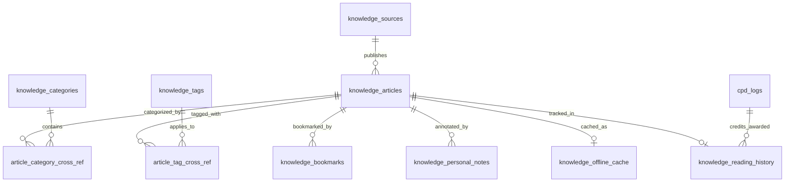
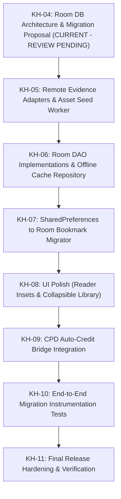

# NURSING SUPER APP — KH-04
## Knowledge Hub 2.0: Room Database Architecture & Migration Proposal

**Document Type:** Senior Android Architectural Specification & Database Migration Proposal  
**Canonical Repository:** `C:\Users\Shaan\StudioProjects\NursingOTApp`  
**Target Path:** `docs/KH-04_Knowledge_Hub_Room_Architecture_and_Migration_Proposal.md`  
**Current Branch:** `fix/mutual-transfer-test-polling-regressions`  
**Current HEAD:** `cb1d47b32cef8e0ab20d5054f76c1261321d6879`  
**Execution Mode:** STRICTLY READ-ONLY ARCHITECTURAL REPORT (Documentation Revision Only)  
**Author:** Senior Android Architect (Room, Jetpack Compose, Healthcare Systems)  
**Date:** November 5, 2026 (Revision 11)  

---

### Statement Classification Legend
Throughout this document, statements, constraints, and recommendations are strictly categorized using the following explicit tags:
- **[VERIFIED CURRENT FACT]** — Directly confirmed through inspection or testing of the local repository code, schemas, and build files.
- **[PROPOSAL]** — Recommended future data model, architectural boundary, algorithm, or migration design.
- **[UNKNOWN]** — Information or metric that cannot be established from the repository's current code or test suites alone.
- **[RISK]** — Identified technical, compatibility, clinical safety, legal, or data-integrity risk.
- **[APPROVAL REQUIRED]** — Architecture, governance, or policy decision reserved explicitly for Pasindu.

---

### Revision 11 Change Log (November 5, 2026)
1. **Durable State B Recovery & Pre-Movement Destination Journaling (Section 8.7):**
   - Eliminated unconditional manifest deletion when the trash binary is missing.
   - Preserves recovery metadata until both physical file integrity (SHA-256) and Room consistency are confirmed.
   - Mandated recording the recovery destination (`recoveryRelativePath`) in the persistent manifest via atomic write before initiating every binary movement.
   - Reconciles both original destination (`originalRelativePath`) and unique recovery destination (`recoveryRelativePath`) if the binary already moved prior to a crash.
   - Handles failed Room updates and zero-row affected returns by preserving metadata and setting `hasUnresolvedTrashErrors = true`.
2. **Deterministic Room-Path Reconciliation & Divergence Classification (Section 8.7):**
   - Defined all permitted Room-path / manifest-path states: Normal Staged Deletion ($P_{room} == P_{orig}$), Prior Recovery Completed ($P_{room} == P_{rec}$), and Room Cleared ($P_{room} == null \lor \text{isFullTextCached} == 0$).
   - Explicitly classified unexplained mismatches ($P_{room} \ne null \land P_{room} \ne P_{orig} \land P_{room} \ne P_{rec}$) as unresolved states: prohibits deleting binaries or manifests and prohibits overwriting Room while paths cannot be reconciled.
3. **Explicitly Typed Multi-Table Reference Resolution (State C) (Section 8.7):**
   - Replaced ambiguous mixed reference handling with a sealed interface `ActiveFileReference` distinguishing `KnowledgeCacheReference` (carrying `articleId`) and `PaySheetDocumentReference` (carrying `paySheetId: Long`).
   - Prohibited treating paysheet records as knowledge articles; implemented dedicated restoration logic and DAO updates for each reference type.
   - Protected every database update with explicit try-catch blocks and verified affected-row counts (`rows > 0`).
4. **Strict Symlink Rejection and Canonical Containment Order (Section 8.7):**
   - Corrected validation order: performed format validation (rejecting null bytes, backslashes, absolute paths, and traversal sequences) followed by component-by-component traversal checks without following symlinks (`LinkOption.NOFOLLOW_LINKS`).
   - Rejects any symlinked ancestor or target before dereferencing, resolving to canonical path only after symlink absence is verified, and enforcing strict vault directory containment.
   - Verified parent directory existence and checked `mkdirs()` return status before performing filesystem writes.
5. **Idempotent Quarantine Recovery & Provenance Invariance (Section 8.7):**
   - Defined the state where quarantine metadata exists but binary movement failed; implemented startup reconciliation that searches the recorded source path, verifies SHA-256, and completes the rename.
   - Guaranteed that quarantined files and manifests preserve full provenance and are permanently shielded from Step 3 orphan pruning and Step 4 purge.
   - Standardized helper contracts: `quarantineFileAtomically` returns an explicit boolean and cleans up `.tmp` files on failure while preserving original binary and metadata.
6. **Platform Filesystem Durability & Boundary Realities (Section 8.7):**
   - Explicitly documented Android internal storage (`context.filesDir`) capabilities: single ext4/f2fs partition boundary satisfying POSIX atomic `rename()`.
   - Distinguished atomic rename, file-data synchronization (`fd.sync()`), and directory-entry durability limitations (directory `fsync` not exposed via standard Java File APIs).
   - Qualified hardware crash guarantees against un-flushed controller cache in sudden battery pulls; avoided impossible hardware-level atomicity claims.
7. **Bookmark Bridge Completion & Persistent Read Guard (Section 4):**
   - Corrected legacy reconciliation completion: when legacy raw storage is initially empty, `KEY_RECONCILIATION_DONE = true` is committed immediately.
   - Wrapped initial persistent-state reads (`isLegacyReconciliationDone`, `getLegacyRawBookmarkIds`) in try-catch blocks, halting gracefully on storage failure without state corruption.
   - Retained the shared `@Singleton BookmarkLock` and immediate loop termination on any batch query, insertion, or commit failure.
8. **Scrubber Operation Verification & Zero-Row Protection (Section 8.7):**
   - Enforced verification on every filesystem operation (`delete()`, `renameTo()`, `mkdirs()`) and Room update.
   - Mandated that a zero-row database update cannot silently retire recovery metadata.
9. **Exhaustive 18-State Scrubber Crash Interruption Matrix (Section 8.7):**
   - Regenerated the matrix directly from the corrected pseudocode, covering missing-binary cases, zero-row database updates, typed cross-table references, quarantine movement failures, and symlink rejection.
10. **Final Self-Consistency Verification (Section 17):**
    - Added an exhaustive self-consistency check confirming that pseudocode, helper contracts, crash matrix, and stated guarantees agree across all 18 states.

---

## Table of Contents
1. [Executive Summary](#1-executive-summary)
2. [Pre-Flight Git and Repository State](#2-pre-flight-git-and-repository-state)
3. [Actual Current Knowledge Hub Architecture](#3-actual-current-knowledge-hub-architecture)
4. [Existing Persistence and Bookmark Compatibility Bridge](#4-existing-persistence-and-bookmark-compatibility-bridge)
5. [Existing CPD and Study Data Ownership](#5-existing-cpd-and-study-data-ownership)
6. [Current Room Database Version and Migration History](#6-current-room-database-version-and-migration-history)
7. [Current Implementation Gaps](#7-current-implementation-gaps)
8. [Proposed Knowledge Hub Data Architecture](#8-proposed-knowledge-hub-data-architecture)
9. [Entity Relationship Diagram](#9-entity-relationship-diagram)
10. [Search Architecture and Full-Text Search (FTS) Evaluation](#10-search-architecture-and-full-text-search-fts-evaluation)
11. [Complete Proposed Additive Migration SQL (v16 -> v17)](#11-complete-proposed-additive-migration-sql-v16---v17)
12. [Migration Test Matrix and Verification Plan](#12-migration-test-matrix-and-verification-plan)
13. [Future UI Requirements from Mobile Screenshots](#13-future-ui-requirements-from-mobile-screenshots)
14. [Content Rights and Evidence Provenance Framework](#14-content-rights-and-evidence-provenance-framework)
15. [Unresolved Questions and Decisions Requiring Approval](#15-unresolved-questions-and-decisions-requiring-approval)
16. [Approved Phased Implementation Roadmap](#16-approved-phased-implementation-roadmap)
17. [Final Confirmation and Safe Stop](#17-final-confirmation-and-safe-stop)

---

## 1. Executive Summary

- **[VERIFIED CURRENT FACT]** The NursingOTApp project (`com.pasindu.nursingotapp`) operates on Room database version **16** across exactly **14 application entity tables** and 13 DAOs.
- **[VERIFIED CURRENT FACT]** In the current version 16 database, the Knowledge Hub feature persists only user-logged Continuing Professional Development records via the `cpd_logs` application table. Clinical evidence articles (`EvidenceArticleItem`) are held as in-memory state in `KnowledgeHubViewModel.kt`, while bookmarks are stored in Android `SharedPreferences` (`knowledge_hub_bookmarks.xml`).
- **[PROPOSAL]** KH-04 specifies an **additive, non-destructive Room migration (`v16 -> v17`)** that introduces **10 new application SQLite tables** (8 entity tables and 2 junction cross-reference tables):
  1. `knowledge_sources` (Source provider register)
  2. `knowledge_articles` (Core clinical evidence articles)
  3. `knowledge_categories` (Category lookup)
  4. `article_category_cross_ref` (Article-to-category junction)
  5. `knowledge_tags` (Clinical tag lookup)
  6. `article_tag_cross_ref` (Article-to-tag junction)
  7. `knowledge_bookmarks` (Room-backed bookmarks)
  8. `knowledge_personal_notes` (Nurse bedside reflections)
  9. `knowledge_offline_cache` (App-private file metadata and checksums)
  10. `knowledge_reading_history` (Reading progress and CPD credit bridge)
- **[PROPOSAL]** The total application table count will advance from **14 application tables to 24 application tables** (excluding SQLite internal metadata tables like `sqlite_master`, `sqlite_sequence`, and `room_master_table`).
- **[VERIFIED CURRENT FACT]** Existing nurse profiles, duty shifts, financial calculations, paysheet document vaults, and mutual transfer caches will remain completely untouched.
- **[PROPOSAL]** A durable two-stage bookmark bridge is designed to ensure legacy bookmark IDs from SharedPreferences are safely reconciled without foreign-key constraint violations when `knowledge_articles` is initially empty after migration.
- **[VERIFIED CURRENT FACT]** Two mobile device screenshots from live testing reveal that while the KH-03 in-app reader and library functional flows succeed, they require dedicated UI polish in KH-08 to resolve floating action bar clipping, navigation bar bleed-through, and excessive hero vertical spacing.
- **[VERIFIED CURRENT FACT]** In accordance with the KH-04 read-only boundary, zero source code, schema, entity, DAO, or Gradle files were modified during this investigation.

---

## 2. Pre-Flight Git and Repository State

### Exact Repository Status
- **Repository Root:** `C:\Users\Shaan\StudioProjects\NursingOTApp`
- **Active Branch:** `fix/mutual-transfer-test-polling-regressions`
- **Current HEAD Commit:** `cb1d47b32cef8e0ab20d5054f76c1261321d6879`
- **Working Tree State:** Exactly **40 tracked modified files** and **12 untracked items** preserved intact:
  ```text
  Tracked Modifications (40 files):
   M .idea/appInsightsSettings.xml
   M .idea/deploymentTargetSelector.xml
   M app/src/androidTest/java/com/pasindu/nursingotapp/data/local/AppDatabaseMigrationTest.kt
   M app/src/main/java/com/pasindu/nursingotapp/data/local/dao/DailyEntryDao.kt
   M app/src/main/java/com/pasindu/nursingotapp/data/local/dao/ProfileDeductionDao.kt
   M app/src/main/java/com/pasindu/nursingotapp/di/UseCaseModule.kt
   M app/src/main/java/com/pasindu/nursingotapp/domain/usecase/DailyEntryUseCases.kt
   M app/src/main/java/com/pasindu/nursingotapp/transfer/ui/TransferIdentityScreen.kt
   M app/src/main/java/com/pasindu/nursingotapp/transfer/ui/TransferRequestScreen.kt
   M app/src/main/java/com/pasindu/nursingotapp/ui/AdvancedFinanceViewModel.kt
   M app/src/main/java/com/pasindu/nursingotapp/ui/ClinicalPlanningViewModel.kt
   M app/src/main/java/com/pasindu/nursingotapp/ui/KnowledgeHubBookmarkStore.kt
   M app/src/main/java/com/pasindu/nursingotapp/ui/KnowledgeHubViewModel.kt
   M app/src/main/java/com/pasindu/nursingotapp/ui/NursingViewModel.kt
   M app/src/main/java/com/pasindu/nursingotapp/ui/components/ElectrolyteReplacementCard.kt
   M app/src/main/java/com/pasindu/nursingotapp/ui/components/InsulinCalculatorCard.kt
   M app/src/main/java/com/pasindu/nursingotapp/ui/components/IvDripCalculatorCard.kt
   M app/src/main/java/com/pasindu/nursingotapp/ui/components/NursingGuideOverlay.kt
   M app/src/main/java/com/pasindu/nursingotapp/ui/components/SedationAnalgesiaCalculatorCard.kt
   M app/src/main/java/com/pasindu/nursingotapp/ui/navigation/AppNavigation.kt
   M app/src/main/java/com/pasindu/nursingotapp/ui/screens/AdvancedFinanceHubScreen.kt
   M app/src/main/java/com/pasindu/nursingotapp/ui/screens/ClaimPeriodModernScreen.kt
   M app/src/main/java/com/pasindu/nursingotapp/ui/screens/ClinicalPlanningDashboardScreen.kt
   M app/src/main/java/com/pasindu/nursingotapp/ui/screens/DailyEntryScreen.kt
   M app/src/main/java/com/pasindu/nursingotapp/ui/screens/DosageCalculatorScreen.kt
   M app/src/main/java/com/pasindu/nursingotapp/ui/screens/HomeScreen.kt
   M app/src/main/java/com/pasindu/nursingotapp/ui/screens/IcuCalculatorScreen.kt
   M app/src/main/java/com/pasindu/nursingotapp/ui/screens/KnowledgeHubModernScreen.kt
   M app/src/main/java/com/pasindu/nursingotapp/ui/screens/PaySheetBankScreen.kt
   M app/src/main/java/com/pasindu/nursingotapp/ui/screens/PaySheetDownloadCenter.kt
   M app/src/main/java/com/pasindu/nursingotapp/ui/screens/PediatricRulesScreen.kt
   M app/src/main/java/com/pasindu/nursingotapp/ui/screens/ProfileCompensationComponents.kt
   M app/src/main/java/com/pasindu/nursingotapp/ui/screens/ProfileScreen.kt
   M app/src/main/java/com/pasindu/nursingotapp/ui/screens/UnitConversionsScreen.kt
   M app/src/main/java/com/pasindu/nursingotapp/ui/screens/VasoactiveInfusionsScreen.kt
   M app/src/main/java/com/pasindu/nursingotapp/ui/screens/WeightInfusionScreen.kt
   M app/src/main/res/xml/backup_rules.xml
   M app/src/main/res/xml/data_extraction_rules.xml
   M app/src/test/java/com/pasindu/nursingotapp/domain/usecase/ClaimPeriodUseCasesTest.kt
   M app/src/test/java/com/pasindu/nursingotapp/ui/AdvancedFinanceUiStateTest.kt

  Untracked Items (12 items):
   ?? app/src/androidTest/assets/com.pasindu.nursingotapp.data.local.AppDatabase/13.json
   ?? app/src/androidTest/assets/com.pasindu.nursingotapp.data.local.AppDatabase/14.json
   ?? app/src/androidTest/assets/com.pasindu.nursingotapp.data.local.AppDatabase/15.json
   ?? app/src/androidTest/assets/com.pasindu.nursingotapp.data.local.AppDatabase/16.json
   ?? app/src/main/java/com/pasindu/nursingotapp/domain/model/KnowledgeEvidenceModels.kt
   ?? app/src/main/java/com/pasindu/nursingotapp/ui/components/EvidenceArticleReaderSheet.kt
   ?? app/src/test/java/com/pasindu/nursingotapp/data/paysheet/
   ?? app/src/test/java/com/pasindu/nursingotapp/transfer/ui/HospitalPickerDialogFilteringTest.kt
   ?? app/src/test/java/com/pasindu/nursingotapp/ui/KnowledgeHubSearchAndReaderTest.kt
   ?? app/src/test/java/com/pasindu/nursingotapp/ui/screens/
   ?? docs/KH-04_Knowledge_Hub_Room_Architecture_and_Migration_Proposal.md
   ?? mutual-transfer-tracked-review.patch
  ```

---

## 3. Actual Current Knowledge Hub Architecture

### Implemented Files
1. `KnowledgeEvidenceModels.kt`:
   - `EvidenceArticleItem`: Core clinical evidence model. Fields include `id`, `title`, `sourceInstitution`, `category`, `clinicalSummary`, `recommendations: List<String>`, `evidenceGrade`, `year`, `lastReviewed`, `sourceUrl`, `isFullTextAvailable`, `tags: List<String>`, `circularNumber: String?`, `effectiveDate: String?`.
   - `CuratedEvidenceSeed`: Hardcoded initial clinical evidence list (e.g. WHO Dengue, MOH Infusion guidelines).
2. `KnowledgeHubBookmarkStore.kt`:
   - SharedPreferences-based persistence storing `Set<String>` under `key = "bookmarked_circular_ids"` in `"knowledge_hub_bookmarks.xml"`.
3. `KnowledgeHubViewModel.kt`:
   - Holds in-memory state via `_uiState = MutableStateFlow(KnowledgeHubUiState(...))`.
   - Combines `CuratedEvidenceSeed.articles` with bookmarks from `KnowledgeHubBookmarkStore`.
4. `KnowledgeHubModernScreen.kt`:
   - Main screen with Search, Category Chips, Evidence List, and Empty States.
5. `EvidenceArticleReaderSheet.kt`:
   - Modal bottom sheet displaying recommendations, key facts, evidence grade tags, and external source link.
6. Tests:
   - `KnowledgeHubSearchAndReaderTest.kt`: 6 unit tests verifying curated evidence loading, search filtering, category filtering, reader sheet open/close state, and reactive bookmark toggling.

---

## 4. Existing Persistence and Bookmark Compatibility Bridge

- **[VERIFIED CURRENT FACT]** Current bookmark persistence relies on:
  ```kotlin
  // File: KnowledgeHubBookmarkStore.kt
  private companion object {
      const val PREFS_NAME = "knowledge_hub_bookmarks"
      const val KEY_BOOKMARKED_IDS = "bookmarked_circular_ids"
  }
  ```
- **[VERIFIED CURRENT FACT]** Saved IDs currently in active use include strings such as `WHO-DENGUE-2024`, `EPMC-SEPSIS-2024`, `RNAO-PRESSURE-2023`, `MOH-INFUSION-2025`, `MOH-2026-04`, `MOH-2026-08`, and `MOH-2026-11`.

### Critical Migration Sequence & Non-Atomic Boundary Analysis
- **[RISK]** **Foreign-Key Violation During Migration Execution:**
  A Room migration (`Migration.migrate(database)`) must execute only DDL statements. Database migrations cannot execute asynchronous repository routines, parse large asset JSON bundles without Android context, or perform network queries. Therefore, immediately after `MIGRATION_16_17` completes, the `knowledge_articles` table is completely empty.
  If the migration or initialization naively attempts to insert legacy bookmark IDs into `knowledge_bookmarks` while a foreign key references `knowledge_articles(id)`, SQLite will throw an immediate `SQLiteConstraintException: FOREIGN KEY constraint failed` and the application will crash on open.
- **[VERIFIED CURRENT FACT]** **Storage Subsystem Non-Atomicity:**
  SQLite (ACID transactional database) and Android `SharedPreferences` (XML file on disk) are fundamentally separate storage subsystems. There is no distributed two-phase commit (2PC) between them. A write to Room can succeed while a write to SharedPreferences fails (or vice versa if the process is killed midway).

### Process-Crash Recovery vs Physical Hardware Failure Guarantees
- **Process Crash Recovery (Guaranteed):** Zero data loss is guaranteed against application process termination, system kills in the background, runtime exceptions, and activity destruction. When `commit()` returns `true` or a Room transaction completes, data has been durably handed over to SQLite WAL and Android's OS kernel buffers. On subsequent launch, startup reconciliation resumes without duplicate errors or data loss.
- **Physical Storage Hardware Failure (Qualified):** In the event of abrupt catastrophic hardware power loss (e.g. battery pulled during active NAND flash cell programming), physical durability is governed by the flash storage controller, hardware wear-leveling buffers, and OS filesystem journaling (ext4/f2fs). While SQLite's Write-Ahead Log (`PRAGMA synchronous = NORMAL / FULL`) and SharedPreferences atomic file renames (`fsync`) provide standard POSIX integrity, no application-level algorithm can overcome un-flushed volatile controller cache truncation during abrupt power loss.

### Injected Repository-Level Lock for Race Prevention
- **[RISK]** **Concurrent State Mutation Race:** If background startup reconciliation runs concurrently with user-driven bookmark toggles on the UI thread, concurrent read-modify-write cycles on `SharedPreferences.getStringSet()` will result in last-write-wins set overwrites, silently dropping bookmarks.
- **[PROPOSAL]** **Single Injected Lock:** An independently created `Mutex()` within the reconciler is strictly prohibited. The reconciler must receive a **shared, singleton repository-level lock** injected via Hilt:
  ```kotlin
  @Singleton
  class BookmarkLock @Inject constructor() {
      val mutex = Mutex()
  }
  ```
  Every bookmark mutation (`toggleBookmark`, `addBookmark`, `removeBookmark`, `runStartupBookmarkReconciliation`, and `reconcileUnresolvedBookmarks`) acquires this identical lock: `bookmarkLock.mutex.withLock { ... }`.

- **[PROPOSAL]** **Durability Rule & Storage Keys:**
  **Core Durability Mandate:** An ID is NEVER removed from raw legacy storage until its replacement is durably persisted in either Room or the persistent unresolved set via verified `commit()`.
  
  ```kotlin
  object BookmarkStorageKeys {
      const val PREFS_NAME = "knowledge_hub_bookmarks"
      const val KEY_LEGACY_RAW_IDS = "bookmarked_circular_ids"            // Original legacy IDs
      const val KEY_UNRESOLVED_IDS = "unresolved_bookmark_ids"           // IDs awaiting article insertion
      const val KEY_ACTIVE_MIRROR = "active_bookmark_mirror"             // UI read-fallback mirror
      const val KEY_RECONCILIATION_DONE = "legacy_reconciliation_done"    // Set true when raw set is empty
  }
  ```

---

### Complete Production Bookmark Reconciliation Algorithm
```kotlin
@Singleton
class KnowledgeBookmarkReconciler @Inject constructor(
    private val knowledgeHubDao: KnowledgeHubDao,
    private val bookmarkStore: KnowledgeHubBookmarkStore,
    private val bookmarkLock: BookmarkLock
) {
    /**
     * Invoked on every application startup during Knowledge Hub initialization.
     * Serialized via the shared BookmarkLock to prevent race conditions with UI actions.
     */
    suspend fun runStartupBookmarkReconciliation() = bookmarkLock.mutex.withLock {
        var reconciliationHalted = false

        // Guarded initial persistent-state read
        val isDone = try {
            bookmarkStore.isLegacyReconciliationDone()
        } catch (e: Exception) {
            Timber.e(e, "Failed to read legacy reconciliation status; HALTING run to prevent state corruption.")
            return@withLock
        }

        // STEP 1: Reconcile Legacy Raw Bookmark IDs (Runs until raw set is fully empty)
        if (!isDone) {
            val rawLegacyIds = try {
                bookmarkStore.getLegacyRawBookmarkIds()
            } catch (e: Exception) {
                Timber.e(e, "Failed to read legacy raw bookmark IDs; HALTING run.")
                return@withLock
            }

            if (rawLegacyIds.isEmpty()) {
                // Raw storage is already empty (fresh install or zero bookmarks); durably mark complete
                val doneCommitted = try {
                    bookmarkStore.setLegacyReconciliationDoneSync(true)
                } catch (e: Exception) {
                    Timber.e(e, "Exception committing legacy reconciliation done flag.")
                    false
                }
                if (!doneCommitted) {
                    Timber.w("Failed to commit legacy reconciliation done flag; will re-verify on next boot.")
                }
            } else {
                val chunks = rawLegacyIds.toList().chunked(50)

                for (batch in chunks) {
                    val batchSet = batch.toSet()

                    // Step 1a: Check which articles currently exist in Room
                    val existingArticleIds = try {
                        knowledgeHubDao.getExistingArticleIds(batch).toSet()
                    } catch (e: Exception) {
                        Timber.e(e, "Room query failed during bookmark batch reconciliation; TERMINATING run.")
                        reconciliationHalted = true
                        break // HALT: Retain remaining raw IDs; retry on next startup
                    }

                    val matchedInBatch = batch.filter { it in existingArticleIds }
                    val unmatchedInBatch = batch.filter { it !in existingArticleIds }

                    // Step 1b: Idempotent insertion into Room for matched articles
                    if (matchedInBatch.isNotEmpty()) {
                        val entities = matchedInBatch.map { id ->
                            KnowledgeBookmarkEntity(
                                articleId = id,
                                bookmarkedAt = System.currentTimeMillis()
                            )
                        }
                        try {
                            knowledgeHubDao.insertBookmarksOrIgnore(entities)
                        } catch (e: Exception) {
                            Timber.e(e, "Room insert failed for matched bookmarks; TERMINATING run.")
                            reconciliationHalted = true
                            break // SQLite transaction rolled back; raw IDs preserved intact
                        }
                    }

                    // Step 1c: Durably persist unmatched IDs into KEY_UNRESOLVED_IDS using commit()
                    if (unmatchedInBatch.isNotEmpty()) {
                        val unresolvedPersisted = try {
                            bookmarkStore.addUnresolvedBookmarkIdsSync(unmatchedInBatch.toSet())
                        } catch (e: Exception) {
                            Timber.e(e, "Exception persisting unresolved bookmark IDs; TERMINATING run.")
                            false
                        }
                        if (!unresolvedPersisted) {
                            Timber.e("Disk commit failed for unresolved bookmark IDs; TERMINATING run.")
                            reconciliationHalted = true
                            break // FAILED DURABLE WRITE: Do NOT prune raw storage; retry later
                        }
                    }

                    // Step 1d: ONLY after Room insert AND unresolved persistence succeed, prune from raw storage
                    val rawPruned = try {
                        bookmarkStore.removeLegacyRawBookmarkIdsSync(batchSet)
                    } catch (e: Exception) {
                        Timber.e(e, "Exception pruning raw IDs; TERMINATING run.")
                        false
                    }
                    if (!rawPruned) {
                        Timber.e("Disk commit failed when pruning raw IDs; TERMINATING run.")
                        reconciliationHalted = true
                        break // Raw IDs retained; next startup will safely re-evaluate
                    }
                }

                // Step 1e: Mark done ONLY if zero batches halted and raw storage is completely empty
                if (!reconciliationHalted) {
                    val remainingRaw = try {
                        bookmarkStore.getLegacyRawBookmarkIds()
                    } catch (e: Exception) {
                        emptySet()
                    }
                    if (remainingRaw.isEmpty()) {
                        val doneCommitted = bookmarkStore.setLegacyReconciliationDoneSync(true)
                        if (!doneCommitted) {
                            Timber.w("Failed to commit legacy reconciliation done flag; will re-verify on next boot.")
                        }
                    }
                }
            }
        }

        // STEP 2: Re-evaluate Unresolved IDs in Case Articles Were Seeded or Ingested
        if (!reconciliationHalted) {
            val unresolvedHalted = reconcileUnresolvedBookmarksInternal()
            if (unresolvedHalted) {
                reconciliationHalted = true
            }
        }

        // STEP 3: Synchronize SharedPreferences Mirror from Authoritative Room State
        syncSharedPreferencesMirrorInternal(reconciliationHalted)
    }

    /**
     * Re-evaluates unresolved IDs against newly ingested articles.
     */
    suspend fun reconcileUnresolvedBookmarks() = bookmarkLock.mutex.withLock {
        val halted = reconcileUnresolvedBookmarksInternal()
        syncSharedPreferencesMirrorInternal(halted)
    }

    /**
     * @return true if reconciliation halted prematurely due to error; false if all batches completed.
     */
    private suspend fun reconcileUnresolvedBookmarksInternal(): Boolean {
        val unresolvedIds = try {
            bookmarkStore.getUnresolvedBookmarkIds()
        } catch (e: Exception) {
            Timber.e(e, "Failed to read unresolved bookmark IDs; TERMINATING unresolved reconciliation.")
            return true
        }
        if (unresolvedIds.isEmpty()) return false

        val chunks = unresolvedIds.toList().chunked(50)
        for (batch in chunks) {
            val existingArticleIds = try {
                knowledgeHubDao.getExistingArticleIds(batch).toSet()
            } catch (e: Exception) {
                Timber.e(e, "Room query failed during unresolved check; TERMINATING run.")
                return true // IMMEDIATE TERMINATION: Do not continue with next batches
            }

            val nowResolvable = batch.filter { it in existingArticleIds }
            if (nowResolvable.isNotEmpty()) {
                val entities = nowResolvable.map { id ->
                    KnowledgeBookmarkEntity(
                        articleId = id,
                        bookmarkedAt = System.currentTimeMillis()
                    )
                }
                try {
                    knowledgeHubDao.insertBookmarksOrIgnore(entities)
                } catch (e: Exception) {
                    Timber.e(e, "Room insert failed for newly resolved bookmarks; TERMINATING run.")
                    return true // IMMEDIATE TERMINATION: Unresolved store preserved intact
                }

                val removed = try {
                    bookmarkStore.removeUnresolvedBookmarkIdsSync(nowResolvable.toSet())
                } catch (e: Exception) {
                    Timber.e(e, "Exception removing resolved IDs from unresolved store; TERMINATING run.")
                    false
                }
                if (!removed) {
                    Timber.e("Disk commit failed when removing resolved IDs from unresolved store; TERMINATING run.")
                    return true // IMMEDIATE TERMINATION: Halts to prevent divergence
                }
            }
        }
        return false
    }

    private suspend fun syncSharedPreferencesMirrorInternal(isReconciliationIncomplete: Boolean) {
        try {
            val authoritativeRoomIds = knowledgeHubDao.getAllBookmarkArticleIds().toSet()
            val unresolvedIds = bookmarkStore.getUnresolvedBookmarkIds()
            val remainingRawIds = if (!bookmarkStore.isLegacyReconciliationDone()) {
                bookmarkStore.getLegacyRawBookmarkIds()
            } else {
                emptySet()
            }

            val completeActiveSet = authoritativeRoomIds + unresolvedIds + remainingRawIds
            bookmarkStore.updateActiveBookmarkMirror(completeActiveSet)

            if (isReconciliationIncomplete) {
                Timber.w("Bookmark mirror updated over partial state; background reconciliation remains incomplete.")
            }
        } catch (e: Exception) {
            Timber.e(e, "SharedPreferences mirror update failed; Room state remains authoritative.")
        }
    }
}
```

---

## 5. Existing CPD and Study Data Ownership

- **[VERIFIED CURRENT FACT]** The `cpd_logs` application table in `AppDatabase.kt` defines:
  ```sql
  CREATE TABLE IF NOT EXISTS `cpd_logs` (
      `id` INTEGER PRIMARY KEY AUTOINCREMENT NOT NULL,
      `seminarTitle` TEXT NOT NULL,
      `date` INTEGER NOT NULL,
      `durationHours` REAL NOT NULL,
      `credits` REAL NOT NULL,
      `notes` TEXT,
      `category` TEXT NOT NULL DEFAULT 'CLINICAL'
  )
  ```
- **[PROPOSAL]** To avoid mutating existing CPD tables, KH-04 specifies an additive bridge table `knowledge_reading_history`:
  - `articleId`: String (PK, FK to `knowledge_articles.id`)
  - `lastReadAt`: Long (timestamp)
  - `readingProgressPercent`: Int (0 to 100)
  - `isCompleted`: Boolean
  - `completedAt`: Long?
  - `linkedCpdLogId`: Int? (FK to `cpd_logs.id` ON DELETE SET NULL)
- **[VERIFIED CURRENT FACT]** Type alignment: `CpdLogEntity.id` is typed as `Int` (`@PrimaryKey(autoGenerate = true) val id: Int = 0`). Consequently, `linkedCpdLogId` in `KnowledgeReadingHistoryEntity` is typed as `Int?` to match SQLite `INTEGER` exactly.

---

## 6. Current Room Database Version and Migration History

- **[VERIFIED CURRENT FACT]** Version 16 is registered in `AppDatabase.kt`:
  ```kotlin
  @Database(
      entities = [
          NurseProfileEntity::class,
          DailyEntryEntity::class,
          MonthlyClaimEntity::class,
          ProfileDeductionEntity::class,
          HolidayEntity::class,
          LeaveEntity::class,
          SalaryScaleEntity::class,
          CpdLogEntity::class,
          PaySheetDocumentEntity::class,
          ShiftArrangementEntity::class,
          StaffMemberEntity::class,
          ShiftAssignmentEntity::class,
          MutualTransferRequestEntity::class,
          MutualTransferMatchEntity::class
      ],
      version = 16,
      exportSchema = true
  )
  ```
- **[VERIFIED CURRENT FACT]** The project contains migration assets `13.json`, `14.json`, `15.json`, and `16.json`.

---

## 7. Current Implementation Gaps

| Area | Current State (v16) | Target State (v17) | Clinical & Safety Impact |
| :--- | :--- | :--- | :--- |
| **Articles** | In-memory `CuratedEvidenceSeed` | Persisted SQLite `knowledge_articles` | Offline access to vital guidelines during ward emergencies. |
| **Search** | Case-insensitive substring match | Indexed SQL queries + planned FTS4/5 | Rapid lookup of critical drug calculations and emergency resuscitation protocols. |
| **Bookmarks** | SharedPreferences `Set<String>` | ACID Room `knowledge_bookmarks` | Durability, zero data loss, and clinical audit trail. |
| **Notes** | Non-existent | `knowledge_personal_notes` | Secure personal clinical reflection and bedside learning. |
| **Offline Cache** | Non-existent | `knowledge_offline_cache` | Full guideline PDF viewing in rural base hospitals without connectivity. |
| **Reading / CPD** | Separate manual `cpd_logs` | Linked `knowledge_reading_history` | Automated CPD credit award upon completing verified evidence readings. |

---

## 8. Proposed Knowledge Hub Data Architecture

### Summary of Proposed Application Tables (10 Total)
1. `knowledge_sources`: Source registries (WHO, SL MoH, RNAO, NICE).
2. `knowledge_articles`: Core clinical evidence repository.
3. `knowledge_categories`: Standard clinical specialty groupings.
4. `article_category_cross_ref`: Article-to-category junction table.
5. `knowledge_tags`: Diagnostic, syndromic, and drug tags.
6. `article_tag_cross_ref`: Article-to-tag junction table.
7. `knowledge_bookmarks`: User bookmarked clinical articles.
8. `knowledge_personal_notes`: Nurse clinical reflections.
9. `knowledge_offline_cache`: Offline document metadata, storage paths, and SHA-256 integrity hashes.
10. `knowledge_reading_history`: Reading progress and link to CPD credits.

---

### Proposed Room Entity Definitions

#### 1. `knowledge_sources`
```kotlin
@Entity(tableName = "knowledge_sources")
data class KnowledgeSourceEntity(
    @PrimaryKey val id: String,
    val name: String,
    val shortCode: String,
    val trustTier: String,
    val websiteUrl: String?,
    val isSystemDefault: Boolean = true,
    val updatedAt: Long = System.currentTimeMillis()
)
```

#### 2. `knowledge_articles`
```kotlin
@Entity(
    tableName = "knowledge_articles",
    foreignKeys = [
        ForeignKey(
            entity = KnowledgeSourceEntity::class,
            parentColumns = ["id"],
            childColumns = ["sourceInstitution"],
            onDelete = ForeignKey.RESTRICT
        )
    ],
    indices = [
        Index(value = ["sourceInstitution"]),
        Index(value = ["category"]),
        Index(value = ["evidenceGrade"]),
        Index(value = ["year"])
    ]
)
data class KnowledgeArticleEntity(
    @PrimaryKey val id: String,
    val title: String,
    val sourceInstitution: String,
    val category: String,
    val clinicalSummary: String,
    val recommendationsJson: String,
    val evidenceGrade: String,
    val year: Int,
    val lastReviewed: String,
    val sourceUrl: String?,
    val circularNumber: String?,
    val effectiveDate: String?,
    val isFullTextAvailable: Boolean = false,
    val licenseNotice: String? = null,
    val sourceUrlDisclaimer: String? = null,
    val isSuperseded: Boolean = false,
    val supersededByArticleId: String? = null,
    val createdAt: Long = System.currentTimeMillis(),
    val updatedAt: Long = System.currentTimeMillis()
)
```

#### 3. `knowledge_categories` & Junction
```kotlin
@Entity(tableName = "knowledge_categories")
data class KnowledgeCategoryEntity(
    @PrimaryKey val id: String,
    val displayName: String,
    val displayOrder: Int = 0
)

@Entity(
    tableName = "article_category_cross_ref",
    primaryKeys = ["articleId", "categoryId"],
    foreignKeys = [
        ForeignKey(
            entity = KnowledgeArticleEntity::class,
            parentColumns = ["id"],
            childColumns = ["articleId"],
            onDelete = ForeignKey.CASCADE
        ),
        ForeignKey(
            entity = KnowledgeCategoryEntity::class,
            parentColumns = ["id"],
            childColumns = ["categoryId"],
            onDelete = ForeignKey.CASCADE
        )
    ],
    indices = [Index(value = ["categoryId"])]
)
data class ArticleCategoryCrossRef(
    val articleId: String,
    val categoryId: String
)
```

#### 4. `knowledge_tags` & Junction
```kotlin
@Entity(tableName = "knowledge_tags")
data class KnowledgeTagEntity(
    @PrimaryKey val tag: String
)

@Entity(
    tableName = "article_tag_cross_ref",
    primaryKeys = ["articleId", "tag"],
    foreignKeys = [
        ForeignKey(
            entity = KnowledgeArticleEntity::class,
            parentColumns = ["id"],
            childColumns = ["articleId"],
            onDelete = ForeignKey.CASCADE
        ),
        ForeignKey(
            entity = KnowledgeTagEntity::class,
            parentColumns = ["tag"],
            childColumns = ["tag"],
            onDelete = ForeignKey.CASCADE
        )
    ],
    indices = [Index(value = ["tag"])]
)
data class ArticleTagCrossRef(
    val articleId: String,
    val tag: String
)
```

#### 5. `knowledge_bookmarks`
```kotlin
@Entity(
    tableName = "knowledge_bookmarks",
    foreignKeys = [
        ForeignKey(
            entity = KnowledgeArticleEntity::class,
            parentColumns = ["id"],
            childColumns = ["articleId"],
            onDelete = ForeignKey.CASCADE
        )
    ]
)
data class KnowledgeBookmarkEntity(
    @PrimaryKey val articleId: String,
    val bookmarkedAt: Long = System.currentTimeMillis()
)
```

#### 6. `knowledge_personal_notes`
```kotlin
@Entity(
    tableName = "knowledge_personal_notes",
    foreignKeys = [
        ForeignKey(
            entity = KnowledgeArticleEntity::class,
            parentColumns = ["id"],
            childColumns = ["articleId"],
            onDelete = ForeignKey.CASCADE
        )
    ],
    indices = [Index(value = ["articleId"])]
)
data class KnowledgePersonalNoteEntity(
    @PrimaryKey(autoGenerate = true) val id: Long = 0L,
    val articleId: String,
    val noteContent: String,
    val createdAt: Long = System.currentTimeMillis(),
    val updatedAt: Long = System.currentTimeMillis()
)
```

#### 7. `knowledge_offline_cache`
```kotlin
@Entity(
    tableName = "knowledge_offline_cache",
    foreignKeys = [
        ForeignKey(
            entity = KnowledgeArticleEntity::class,
            parentColumns = ["id"],
            childColumns = ["articleId"],
            onDelete = ForeignKey.CASCADE
        )
    ]
)
data class KnowledgeOfflineCacheEntity(
    @PrimaryKey val articleId: String,
    val localRelativePath: String?,
    val mimeType: String = "application/pdf",
    val fileSizeBytes: Long = 0L,
    val sha256Hash: String,
    val cachedAt: Long = System.currentTimeMillis(),
    val lastAccessedAt: Long = System.currentTimeMillis(),
    val isFullTextCached: Int = 1
)
```

---

### Strict Data-Safety File Scrubber & Recovery Architecture

#### 1. Manifest-Backed Quarantine Protocol & Idempotent Recovery
- **Segregated Vault Topology:**
  `knowledge_vault/` contains three strictly isolated subtrees:
  - `knowledge_vault/` (Root holding active cached documents)
  - `knowledge_vault/.trash/` (Temporary staging directory for deletions)
  - `knowledge_vault/quarantine/` (Permanent isolation for integrity mismatches)
- **Safe Generated Filenames:**
  Direct string interpolation of external article IDs into filesystem paths is strictly prohibited. Every quarantine record is stored with a UUID-generated filename:
  - Binary: `knowledge_vault/quarantine/${quarantineId}.quarantine`
  - Companion Manifest: `knowledge_vault/quarantine/${quarantineId}.quarantine.meta`
- **Quarantine Manifest Schema:**
  ```json
  {
    "quarantineId": "9b1deb4d-3b7d-4bad-9bdd-2b0d7b3dcb6d",
    "originalArticleId": "WHO-DENGUE-2024",
    "originalSourcePath": "guidelines/dengue_v4.pdf",
    "expectedSha256": "e3b0c44298fc1c149afbf4c8996fb92427ae41e4649b934ca495991b7852b855",
    "actualSha256": "f4c281...actualHash",
    "quarantinedAt": 1700000000000,
    "quarantineReason": "CHECKSUM_MISMATCH"
  }
  ```
- **Atomic Quarantine Publication:**
  When moving a file to quarantine:
  1. Write companion manifest to `${quarantineId}.quarantine.meta.tmp`.
  2. Flush user-space buffers and synchronize file descriptor (`fd.sync()`).
  3. Validate serialized JSON.
  4. Atomically rename to `${quarantineId}.quarantine.meta`.
  5. Move binary to `${quarantineId}.quarantine`.
  6. Only after both moves succeed, retire or unlink the source metadata.
- **Incomplete Quarantine Recovery:**
  If a crash occurs between manifest publication (step 4) and binary movement (step 5), `${quarantineId}.quarantine.meta` exists without the `${quarantineId}.quarantine` binary. During startup quarantine reconciliation:
  - Inspect `originalSourcePath`. If the source binary exists and matches `actualSha256`, complete the rename to `${quarantineId}.quarantine`.
  - If the source binary is missing, preserve the manifest with an error log for administrative review; never delete quarantine manifests.
- **Permanent Quarantine Shield:** Step 3 orphan pruning scans only the vault root and explicitly skips `quarantine/`. Quarantined files are permanently shielded from deletion.

#### 2. Strict Symlink Rejection and Canonical Containment Order
- **Format Validation:**
  Reject null, empty, absolute paths (`File(path).isAbsolute`), Windows drive prefixes (`C:`), null bytes (`\0`), backslashes (`\`), and path traversal sequences (`..`).
- **Component-by-Component Unresolved Traversal Check (No-Follow):**
  Validate the path step-by-step without following symlinks:
  ```kotlin
  fun validateVaultPath(vaultDir: File, relativePath: String): File {
      require(!relativePath.startsWith("/") && !relativePath.contains("\\") && !relativePath.contains("\u0000")) {
          "Security violation: malformed path sequence: $relativePath"
      }
      require(!relativePath.split("/").any { it == ".." || it.isBlank() }) {
          "Security violation: path traversal sequence detected: $relativePath"
      }

      val realVaultPath = vaultDir.toPath().toRealPath()
      var currentPath = realVaultPath

      // Check each segment without following symlinks
      for (part in relativePath.split("/")) {
          currentPath = currentPath.resolve(part)
          if (Files.isSymbolicLink(currentPath)) {
              throw SecurityException("Security violation: symbolic link encountered in path: $currentPath")
          }
      }

      // Canonical containment verification
      val canonicalTarget = currentPath.toFile().canonicalFile
      val canonicalVault = vaultDir.canonicalFile
      if (!canonicalTarget.path.startsWith(canonicalVault.path + File.separator)) {
          throw SecurityException("Security violation: target resolved outside vault boundary: $relativePath")
      }
      return canonicalTarget
  }
  ```
- **Checked Directory Creation:**
  Before writing any file, verify `parentFile.exists() || parentFile.mkdirs()`. If directory creation fails, operations immediately halt without attempting writes.

#### 3. Platform Filesystem Durability & Boundary Realities
- **POSIX Same-Filesystem Boundary:** On Android devices, `context.filesDir` is hosted on a single unified ext4 or f2fs user partition. Moving files between `knowledge_vault/`, `.trash/`, and `quarantine/` operates strictly within the same filesystem mount, satisfying POSIX requirements for atomic `rename()` syscalls (`renameat()`).
- **Data Durability (`fsync`):** Calling `FileOutputStream.flush()` only pushes bytes to the OS kernel page cache. Physical persistence to flash controller buffers requires calling `fos.fd.sync()` (issuing `fsync`).
- **Directory-Entry Durability Limitation:** In pure POSIX, guaranteeing that a `rename()` or newly created file entry survives sudden hardware power loss requires syncing parent directory file descriptors (`fsync(dirFd)`). Standard Java `File` and Android high-level APIs do not expose public directory `fsync` methods without native JNI calls. Therefore:
  - Zero data loss is guaranteed against process crashes, background OS kills, and runtime exceptions.
  - In catastrophic abrupt hardware power loss (battery pulled during flash cell programming), durability is bounded by ext4/f2fs journal commits (typically 5 seconds on Android).
  - The architecture does not claim impossible hardware-level atomicity; instead, it enforces idempotent startup reconciliation so that whatever state exists on reboot, the system safely converges.

#### 4. Complete Scope of Database File References & Typed References
A file on disk is referenced if its relative path matches any active record in the database across all modules. To eliminate ambiguous mixed reference handling, reference queries return explicitly typed results:
```kotlin
sealed interface ActiveFileReference {
    val relativePath: String

    data class KnowledgeCacheReference(
        val articleId: String,
        override val relativePath: String,
        val sha256Hash: String
    ) : ActiveFileReference

    data class PaySheetDocumentReference(
        val paySheetId: Long,
        override val relativePath: String
    ) : ActiveFileReference
}
```

- **Permitted Room-Path / Manifest-Path Combinations:**
  Let `manifest.originalRelativePath` = $P_{orig}$, `manifest.recoveryRelativePath` = $P_{rec}$, and Room `articleRecord.localRelativePath` = $P_{room}$.
  1. **Normal Staged Deletion State:** $P_{room} == P_{orig}$. The file was staged from its original path; Room has not yet been deleted.
  2. **Prior Recovery Completed:** $P_{room} == P_{rec}$. A prior recovery run already updated Room to the recovery path.
  3. **Room Cleared:** $P_{room} == null$ or `isFullTextCached == 0` (State C: deletion committed in Room).
  4. **Unexplained Divergence:** $P_{room} \ne null \land P_{room} \ne P_{orig} \land P_{room} \ne P_{rec}$. Treated as an **UNRESOLVED STATE**. Prohibits deleting binaries or manifests; leaves state intact with `hasUnresolvedTrashErrors = true` for administrator review.

---

### Complete Production-Grade Startup Scrubber Algorithm
```kotlin
@Singleton
class KnowledgeOfflineScrubber @Inject constructor(
    @ApplicationContext private val context: Context,
    private val offlineCacheDao: KnowledgeOfflineCacheDao,
    private val paySheetDao: PaySheetDao,
    private val vaultLock: VaultLock
) {
    private val vaultDir: File by lazy {
        File(context.filesDir, "knowledge_vault").canonicalFile.apply {
            check(exists() || mkdirs()) { "Failed to create vault directory" }
        }
    }
    private val trashDir: File by lazy {
        File(vaultDir, ".trash").canonicalFile.apply {
            check(exists() || mkdirs()) { "Failed to create trash directory" }
        }
    }
    private val quarantineDir: File by lazy {
        File(vaultDir, "quarantine").canonicalFile.apply {
            check(exists() || mkdirs()) { "Failed to create quarantine directory" }
        }
    }

    suspend fun runStartupScrubber() = vaultLock.mutex.withLock {
        var hasUnresolvedTrashErrors = false
        var abortDestructiveOperations = false

        // =========================================================================
        // STEP 0: Reconcile Incomplete Quarantine Operations
        // =========================================================================
        val qMetaFiles = quarantineDir.listFiles { _, name -> name.endsWith(".quarantine.meta") } ?: emptyArray()
        for (qMetaFile in qMetaFiles) {
            val qManifest = parseQuarantineManifest(qMetaFile) ?: continue
            val qBinary = File(quarantineDir, "${qManifest.quarantineId}.quarantine")
            if (!qBinary.exists()) {
                // Incomplete quarantine: binary move crashed after manifest write
                val sourceFile = File(vaultDir, qManifest.originalSourcePath)
                if (sourceFile.exists() && computeSha256(sourceFile) == qManifest.actualSha256) {
                    if (!sourceFile.renameTo(qBinary)) {
                        hasUnresolvedTrashErrors = true
                    }
                } else {
                    Timber.w("Quarantine binary missing and source not found for ${qManifest.quarantineId}. Preserving manifest.")
                    hasUnresolvedTrashErrors = true
                }
            }
        }

        // =========================================================================
        // STEP 1: Reconcile Staged Trash Files (State B & State C Crash Recovery)
        // =========================================================================
        val metaFiles = trashDir.listFiles { _, name -> name.endsWith(".meta") } ?: emptyArray()
        for (metaFile in metaFiles) {
            if (abortDestructiveOperations) break

            val manifest = parseTrashManifest(metaFile)
            if (manifest == null) {
                Timber.w("Corrupted trash manifest: ${metaFile.name}. Preserving for review.")
                hasUnresolvedTrashErrors = true
                continue
            }

            val trashBinary = File(trashDir, "${manifest.trashId}.trash")
            if (!trashBinary.exists()) {
                // Binary missing: check candidate recovery locations
                val candidatePath = manifest.recoveryRelativePath ?: manifest.originalRelativePath
                val candidateFile = File(vaultDir, candidatePath)

                if (candidateFile.exists() && computeSha256(candidateFile) == manifest.sha256Hash) {
                    // Binary already restored prior to crash; verify and reconcile Room consistency
                    val articleRecord = try {
                        offlineCacheDao.getByArticleId(manifest.articleId)
                    } catch (e: Exception) {
                        abortDestructiveOperations = true
                        hasUnresolvedTrashErrors = true
                        break
                    }

                    if (articleRecord != null && articleRecord.isFullTextCached == 1) {
                        if (articleRecord.localRelativePath != candidatePath) {
                            val rows = try {
                                offlineCacheDao.updateRelativePath(manifest.articleId, candidatePath)
                            } catch (e: Exception) {
                                abortDestructiveOperations = true
                                0
                            }
                            if (rows > 0) {
                                metaFile.delete()
                                continue
                            } else {
                                hasUnresolvedTrashErrors = true
                                continue
                            }
                        } else {
                            // Room already points to verified recovered file; safe to retire manifest
                            metaFile.delete()
                            continue
                        }
                    } else {
                        // Room record was deleted; check cross-table references
                        val refs = getActiveReferencesForPath(candidatePath)
                        if (refs.isNotEmpty()) {
                            metaFile.delete()
                            continue
                        }
                    }
                }

                // If binary is neither in trash nor verified at destination: PRESERVE MANIFEST
                Timber.w("Trash binary missing and unverified on disk: ${manifest.trashId}. Retaining manifest.")
                hasUnresolvedTrashErrors = true
                continue
            }

            // Universal Cryptographic Verification
            val actualTrashHash = computeSha256(trashBinary)
            if (actualTrashHash != manifest.sha256Hash) {
                Timber.e("Trash binary checksum mismatch for ${manifest.trashId}. Quarantining.")
                val qId = UUID.randomUUID().toString()
                if (quarantineFileAtomically(trashBinary, manifest.articleId, manifest.originalRelativePath, manifest.sha256Hash, actualTrashHash, qId, "TRASH_CHECKSUM_MISMATCH")) {
                    metaFile.delete()
                } else {
                    hasUnresolvedTrashErrors = true
                }
                continue
            }

            // Query active Room records referencing this article ID
            val articleRecord = try {
                offlineCacheDao.getByArticleId(manifest.articleId)
            } catch (e: Exception) {
                Timber.e(e, "Database query failed for article ${manifest.articleId}; triggering global abort.")
                abortDestructiveOperations = true
                hasUnresolvedTrashErrors = true
                break
            }

            if (articleRecord != null && articleRecord.isFullTextCached == 1) {
                // -------------------------------------------------------------
                // STATE B RECOVERY: Staged move succeeded, Room delete crashed
                // -------------------------------------------------------------
                if (actualTrashHash != articleRecord.sha256Hash) {
                    Timber.e("Trash binary does not match active Room checksum. Quarantining.")
                    val qId = UUID.randomUUID().toString()
                    if (quarantineFileAtomically(trashBinary, manifest.articleId, manifest.originalRelativePath, manifest.sha256Hash, actualTrashHash, qId, "ROOM_CHECKSUM_MISMATCH")) {
                        metaFile.delete()
                        val rows = try {
                            offlineCacheDao.updateCacheStatus(manifest.articleId, isFullTextCached = 0, path = null)
                        } catch (e: Exception) {
                            abortDestructiveOperations = true
                            0
                        }
                        if (rows == 0) hasUnresolvedTrashErrors = true
                    } else {
                        hasUnresolvedTrashErrors = true
                    }
                    continue
                }

                // Classify Room-path / manifest-path combination
                val pOrig = manifest.originalRelativePath
                val pRec = manifest.recoveryRelativePath
                val pRoom = articleRecord.localRelativePath

                if (pRoom != null && pRoom != pOrig && pRoom != pRec) {
                    Timber.w("Unexplained Room path divergence ($pRoom vs $pOrig / $pRec). Retaining unresolved state.")
                    hasUnresolvedTrashErrors = true
                    continue // UNRESOLVED: Prohibit deletion of binary or manifest
                }

                val targetPath = pRec ?: pOrig
                val targetVaultFile = validateVaultPath(vaultDir, targetPath)

                if (targetVaultFile.exists()) {
                    val destHash = computeSha256(targetVaultFile)
                    if (destHash == articleRecord.sha256Hash) {
                        if (trashBinary.delete()) {
                            metaFile.delete()
                        } else {
                            hasUnresolvedTrashErrors = true
                        }
                    } else {
                        // Collision with differing content: Assign unique recovery destination
                        val recUuid = UUID.randomUUID().toString()
                        val recRelativePath = "$recUuid.recovered.pdf"
                        val recoveryFile = File(vaultDir, recRelativePath)

                        // Journal destination in manifest BEFORE binary movement
                        manifest.recoveryRelativePath = recRelativePath
                        val updatedManifestJson = serializeTrashManifest(manifest)
                        if (atomicWriteManifest(metaFile, updatedManifestJson)) {
                            if (!recoveryFile.exists() && trashBinary.renameTo(recoveryFile)) {
                                val rows = try {
                                    offlineCacheDao.updateRelativePath(manifest.articleId, recRelativePath)
                                } catch (e: Exception) {
                                    abortDestructiveOperations = true
                                    0
                                }
                                if (rows > 0) {
                                    metaFile.delete()
                                } else {
                                    hasUnresolvedTrashErrors = true
                                }
                            } else {
                                hasUnresolvedTrashErrors = true
                            }
                        } else {
                            hasUnresolvedTrashErrors = true
                        }
                    }
                } else {
                    // Journal recovery path before binary movement
                    manifest.recoveryRelativePath = targetPath
                    val updatedManifestJson = serializeTrashManifest(manifest)
                    if (atomicWriteManifest(metaFile, updatedManifestJson)) {
                        targetVaultFile.parentFile?.let { if (!it.exists()) it.mkdirs() }
                        if (trashBinary.renameTo(targetVaultFile)) {
                            val rows = try {
                                offlineCacheDao.updateRelativePath(manifest.articleId, targetPath)
                            } catch (e: Exception) {
                                abortDestructiveOperations = true
                                0
                            }
                            if (rows > 0) {
                                metaFile.delete()
                            } else {
                                hasUnresolvedTrashErrors = true
                            }
                        } else {
                            hasUnresolvedTrashErrors = true
                        }
                    } else {
                        hasUnresolvedTrashErrors = true
                    }
                }
            } else {
                // -------------------------------------------------------------
                // STATE C RECOVERY: Room record deleted; verify typed references
                // -------------------------------------------------------------
                val activeReferences = try {
                    getActiveReferencesForPath(manifest.originalRelativePath)
                } catch (e: Exception) {
                    Timber.e(e, "Cross-table reference check failed; triggering global abort.")
                    abortDestructiveOperations = true
                    hasUnresolvedTrashErrors = true
                    break
                }

                if (activeReferences.isEmpty()) {
                    // Zero active references across all tables: safe to unlink
                    if (trashBinary.delete()) {
                        metaFile.delete()
                    } else {
                        hasUnresolvedTrashErrors = true
                    }
                } else {
                    // Active reference exists elsewhere: restore file and reconcile referencing table
                    val restoreTarget = validateVaultPath(vaultDir, manifest.originalRelativePath)
                    var finalRestoredPath = manifest.originalRelativePath

                    if (restoreTarget.exists()) {
                        val destHash = computeSha256(restoreTarget)
                        if (destHash == manifest.sha256Hash) {
                            trashBinary.delete()
                            metaFile.delete()
                            continue
                        } else {
                            // Collision: journal recovery path before moving
                            val recUuid = UUID.randomUUID().toString()
                            finalRestoredPath = "$recUuid.recovered.pdf"
                            manifest.recoveryRelativePath = finalRestoredPath
                            if (!atomicWriteManifest(metaFile, serializeTrashManifest(manifest))) {
                                hasUnresolvedTrashErrors = true
                                continue
                            }
                            val recFile = File(vaultDir, finalRestoredPath)
                            if (!trashBinary.renameTo(recFile)) {
                                hasUnresolvedTrashErrors = true
                                continue
                            }
                        }
                    } else {
                        restoreTarget.parentFile?.let { if (!it.exists()) it.mkdirs() }
                        if (!trashBinary.renameTo(restoreTarget)) {
                            hasUnresolvedTrashErrors = true
                            continue
                        }
                    }

                    // Update referencing records based on explicit type
                    var allUpdatesSucceeded = true
                    for (ref in activeReferences) {
                        val updatedRows = try {
                            when (ref) {
                                is ActiveFileReference.KnowledgeCacheReference ->
                                    offlineCacheDao.updateRelativePath(ref.articleId, finalRestoredPath)
                                is ActiveFileReference.PaySheetDocumentReference ->
                                    paySheetDao.updateLocalPdfPath(ref.paySheetId, finalRestoredPath)
                            }
                        } catch (e: Exception) {
                            abortDestructiveOperations = true
                            0
                        }
                        if (updatedRows == 0) allUpdatesSucceeded = false
                    }

                    if (allUpdatesSucceeded) {
                        metaFile.delete()
                    } else {
                        hasUnresolvedTrashErrors = true
                    }
                }
            }
        }

        // =========================================================================
        // STEP 2: Inspect Database Records for Missing / Corrupted Files
        // =========================================================================
        if (!abortDestructiveOperations) {
            val cachedRecords = try {
                offlineCacheDao.getAllFullTextCached()
            } catch (e: Exception) {
                Timber.e(e, "Failed to load cached records from Room; triggering global abort.")
                abortDestructiveOperations = true
                hasUnresolvedTrashErrors = true
                emptyList()
            }

            for (record in cachedRecords) {
                if (abortDestructiveOperations) break
                val relativePath = record.localRelativePath
                if (relativePath == null || relativePath.startsWith("quarantine/")) continue

                val fileInVault = validateVaultPath(vaultDir, relativePath)
                if (!fileInVault.exists()) {
                    val rows = try {
                        offlineCacheDao.updateCacheStatus(record.articleId, isFullTextCached = 0, path = null)
                    } catch (e: Exception) {
                        abortDestructiveOperations = true
                        0
                    }
                    if (rows == 0) hasUnresolvedTrashErrors = true
                } else {
                    val actualHash = computeSha256(fileInVault)
                    if (actualHash != record.sha256Hash) {
                        val qId = UUID.randomUUID().toString()
                        if (quarantineFileAtomically(fileInVault, record.articleId, relativePath, record.sha256Hash, actualHash, qId, "VAULT_CHECKSUM_MISMATCH")) {
                            val rows = try {
                                offlineCacheDao.updateCacheStatus(record.articleId, isFullTextCached = 0, path = "quarantine/$qId.quarantine")
                            } catch (e: Exception) {
                                abortDestructiveOperations = true
                                0
                            }
                            if (rows == 0) hasUnresolvedTrashErrors = true
                        } else {
                            hasUnresolvedTrashErrors = true
                        }
                    }
                }
            }
        }

        // =========================================================================
        // STEP 3: Scan knowledge_vault/ for Unreferenced Orphan Files
        // =========================================================================
        if (!abortDestructiveOperations) {
            val activeDbPaths = try {
                val cachePaths = offlineCacheDao.getAllActivePaths()
                val paySheetPaths = paySheetDao.getAllActivePdfPaths()
                (cachePaths + paySheetPaths).toSet()
            } catch (e: Exception) {
                Timber.e(e, "Database query failed for active paths; ABORTING orphan scan.")
                abortDestructiveOperations = true
                return@withLock
            }

            val vaultFiles = vaultDir.walkTopDown().filter { file ->
                file.isFile &&
                !file.path.startsWith(trashDir.path) &&
                !file.path.startsWith(quarantineDir.path)
            }.toList()

            for (vaultFile in vaultFiles) {
                if (abortDestructiveOperations) break
                val relativePath = vaultFile.toRelativeString(vaultDir).replace("\\", "/")

                if (relativePath !in activeDbPaths) {
                    val orphanId = UUID.randomUUID().toString()
                    val targetTrash = File(trashDir, "$orphanId.trash")
                    val targetMeta = File(trashDir, "$orphanId.meta")
                    val orphanHash = computeSha256(vaultFile)
                    val metaJson = buildTrashManifestJson(orphanId, "ORPHAN", relativePath, orphanHash)

                    if (atomicWriteManifest(targetMeta, metaJson)) {
                        if (vaultFile.renameTo(targetTrash)) {
                            if (targetTrash.delete()) {
                                targetMeta.delete()
                            } else {
                                hasUnresolvedTrashErrors = true
                            }
                        } else {
                            targetMeta.delete()
                            hasUnresolvedTrashErrors = true
                        }
                    } else {
                        hasUnresolvedTrashErrors = true
                    }
                }
            }
        }

        // =========================================================================
        // STEP 4: Per-File Eligibility Check for Final Trash Cleanup
        // =========================================================================
        if (!abortDestructiveOperations) {
            val remainingBinaries = trashDir.listFiles { _, name -> name.endsWith(".trash") } ?: emptyArray()
            for (binary in remainingBinaries) {
                if (abortDestructiveOperations) break

                val trashId = binary.name.removeSuffix(".trash")
                val metaFile = File(trashDir, "$trashId.meta")
                if (!metaFile.exists()) {
                    Timber.w("Trash binary without manifest: ${binary.name}. Quarantining before moving.")
                    val qId = UUID.randomUUID().toString()
                    val actualHash = computeSha256(binary)
                    quarantineFileAtomically(binary, "UNKNOWN_PROVENANCE", "UNKNOWN", "UNKNOWN", actualHash, qId, "MISSING_TRASH_MANIFEST")
                    continue
                }

                val manifest = parseTrashManifest(metaFile) ?: continue
                val references = try {
                    getActiveReferencesForPath(manifest.originalRelativePath)
                } catch (e: Exception) {
                    Timber.e(e, "Database reference query failed during Step 4; triggering global abort.")
                    abortDestructiveOperations = true
                    break
                }

                if (references.isEmpty() && computeSha256(binary) == manifest.sha256Hash) {
                    if (binary.delete()) {
                        metaFile.delete()
                    }
                }
            }
        }
    }

    private fun atomicWriteManifest(targetFile: File, jsonContent: String): Boolean {
        val tmpFile = File(targetFile.parentFile, "${targetFile.name}.tmp")
        return try {
            FileOutputStream(tmpFile).use { fos ->
                fos.write(jsonContent.toByteArray(Charsets.UTF_8))
                fos.flush()
                fos.fd.sync()
            }
            if (tmpFile.length() == 0L || !isValidJson(tmpFile)) {
                tmpFile.delete()
                return false
            }
            tmpFile.renameTo(targetFile)
        } catch (e: Exception) {
            tmpFile.delete()
            false
        }
    }

    private fun quarantineFileAtomically(
        binary: File,
        articleId: String,
        sourcePath: String,
        expectedHash: String,
        actualHash: String,
        qId: String,
        reason: String
    ): Boolean {
        val qMeta = buildQuarantineManifestJson(qId, articleId, sourcePath, expectedHash, actualHash, reason)
        val qMetaFile = File(quarantineDir, "$qId.quarantine.meta")
        val qBinaryFile = File(quarantineDir, "$qId.quarantine")

        return if (atomicWriteManifest(qMetaFile, qMeta)) {
            if (binary.renameTo(qBinaryFile)) {
                true
            } else {
                // Binary rename failed; clean up metadata to maintain 1:1 invariant
                qMetaFile.delete()
                false
            }
        } else {
            false
        }
    }

    private suspend fun getActiveReferencesForPath(relativePath: String): List<ActiveFileReference> {
        val results = mutableListOf<ActiveFileReference>()
        val cacheRecord = offlineCacheDao.getByPath(relativePath)
        if (cacheRecord != null && cacheRecord.isFullTextCached == 1) {
            results.add(ActiveFileReference.KnowledgeCacheReference(cacheRecord.articleId, relativePath, cacheRecord.sha256Hash))
        }
        val paySheetRecords = paySheetDao.getByPath(relativePath)
        for (ps in paySheetRecords) {
            results.add(ActiveFileReference.PaySheetDocumentReference(ps.id, relativePath))
        }
        return results
    }
}
```

---

### Exhaustive 18-State Scrubber Crash Interruption Matrix
| # | Interruption Point / Failure State | System State on Disk and Database | Scrubber Recovery Action on Subsequent Boot | Resulting System Guarantee |
| :--- | :--- | :--- | :--- | :--- |
| **1** | **Partial manifest write (`.meta.tmp`)** | Vault file intact; partial `.meta.tmp` in trash. | Scrubber ignores/prunes `.tmp`; vault file intact. | Manifest never published in partial state. |
| **2** | **Failed atomic publication (`renameTo` false)** | Vault file intact; `.meta.tmp` unrenamed. | Write returns false; binary move aborted; `.tmp` cleaned. | Binary is never moved without manifest. |
| **3** | **Crash post-meta write pre-binary move** | Binary in vault; valid `.meta` in trash. | Scrubber sees `.meta` without `.trash`; verifies candidate path, leaves vault intact. | Atomicity preserved; zero data loss. |
| **4** | **Crash post-staging pre-Room delete (State B)** | Binary in `${uuid}.trash` with `.meta`; DB active. | Scrubber Step 1 validates dual checksum; journals destination; restores binary. | Consistency restored; zero dangling pointer. |
| **5** | **State B recovery move completed pre-crash, DB update pending** | Binary restored to vault; manifest exists in trash; DB unupdated. | Step 1 detects binary at destination, verifies SHA-256, updates Room, deletes `.meta`. | Heals Room path without re-copying binary. |
| **6** | **Missing trash binary and unverified candidate destination** | Manifest in `.trash/`; binary missing in trash and destination. | Step 1 logs warning; retains `.meta`; flags `hasUnresolvedTrashErrors = true`. | Never deletes manifest while binary is unaccounted for. |
| **7** | **State B Room update failure (exception or 0 rows)** | Binary moved to destination; Room update fails or returns 0. | Manifest retained on disk; error flagged; next startup retries Room update. | Metadata preserved until Room confirms consistency. |
| **8** | **State B destination collision with differing content** | File exists at destination with different hash. | Step 1 journals `$recUuid.recovered.pdf` in manifest; moves binary; updates Room. | Never overwrites destination file. |
| **9** | **Unexplained Room path divergence ($P_{room} \ne P_{orig} \land P_{room} \ne P_{rec}$)** | Room points to third path; manifest in trash. | Classified as UNRESOLVED; binary and manifest retained; Room untouched. | Prevents silent data clobbering under race conditions. |
| **10** | **Crash post-Room delete pre-unlink (State C, 0 references)** | DB record deleted; binary in `.trash/`; 0 references. | Step 1 verifies 0 active references; unlinks binary & manifest. | Zero disk leak; valid files untouched. |
| **11** | **State C KnowledgeCache reference detected** | Room article deleted, but another cache entry references path. | Restores binary to vault; updates referencing article; verifies affected rows. | Multi-reference integrity preserved. |
| **12** | **State C PaySheetDocument reference detected** | Knowledge cache deleted; paysheet document references path. | Restores binary; updates `pay_sheet_documents` via `paySheetId`; verifies rows. | Cross-module paysheet PDFs strictly protected. |
| **13** | **Quarantine metadata write failure** | Binary in vault/trash; quarantine `.meta.tmp` fails. | Quarantine returns false; binary retained in place; DB active. | Files never quarantined without valid metadata. |
| **14** | **Quarantine binary move failure** | Quarantine manifest published; binary move fails. | Helper deletes published quarantine manifest; binary preserved in source. | Enforces 1:1 binary-to-manifest quarantine invariant. |
| **15** | **Incomplete quarantine recovery (Step 0)** | Manifest in `quarantine/`; binary in vault/trash. | Step 0 inspects source path, validates SHA-256, and completes move to quarantine. | Self-healing recovery for interrupted quarantines. |
| **16** | **Symlink detected in path or ancestor component** | Symlink detected via `Files.isSymbolicLink(NOFOLLOW_LINKS)`. | `SecurityException` thrown immediately; operation aborts before file access. | Path traversal and jailbreak attacks strictly blocked. |
| **17** | **Database failure in any scrubber step** | SQLite query or update throws exception. | Global abort flag immediately halts all deletions across all steps. | Fails safe; never treats error as empty reference list. |
| **18** | **Concurrent cache operations during scrubber** | UI or download tries to mutate vault during scrubber. | Operations serialized via `VaultLock.mutex`. | Zero reference-to-delete race conditions. |

---

#### 8. `knowledge_reading_history` (Progress & CPD Bridge)
- **Room Entity Definition:**
  ```kotlin
  @Entity(
      tableName = "knowledge_reading_history",
      foreignKeys = [
        ForeignKey(
            entity = KnowledgeArticleEntity::class,
            parentColumns = ["id"],
            childColumns = ["articleId"],
            onDelete = ForeignKey.CASCADE
        ),
        ForeignKey(
            entity = CpdLogEntity::class,
            parentColumns = ["id"],
            childColumns = ["linkedCpdLogId"],
            onDelete = ForeignKey.SET_NULL
        )
      ],
      indices = [Index(value = ["linkedCpdLogId"])]
  )
  data class KnowledgeReadingHistoryEntity(
      @PrimaryKey val articleId: String,
      val lastReadAt: Long,
      val readingProgressPercent: Int = 0,
      val isCompleted: Boolean = false,
      val completedAt: Long? = null,
      val linkedCpdLogId: Int? = null
  )
  ```

---

## 9. Entity Relationship Diagram



---

## 10. Search Architecture and Full-Text Search (FTS) Evaluation

- **[VERIFIED CURRENT FACT]** Currently, Knowledge Hub searches 10 curated articles in memory using Kotlin `String.contains(query, ignoreCase = true)`.
- **[PROPOSAL]** Two-Stage Database Search Strategy:
  - **Stage 1 (KH-04): Standard Indexed SQL LIKE Search:**
    ```sql
    SELECT * FROM knowledge_articles
    WHERE title LIKE '%' || :query || '%'
       OR clinicalSummary LIKE '%' || :query || '%'
       OR recommendationsJson LIKE '%' || :query || '%'
    ORDER BY year DESC, title ASC
    ```
    B-tree indices on `category`, `evidenceGrade`, and `year` optimize filtered queries.
  - **Stage 2 (KH-06 Evaluation): SQLite FTS4 / FTS5 Full-Text Search:**
    When the evidence catalog grows beyond 500 documents, introduce a virtual table `knowledge_articles_fts` using `FTS4` (standard Android SQLite support across Android 8.0+ / API 26+).

---

## 11. Complete Proposed Additive Migration SQL (v16 -> v17)

```kotlin
val MIGRATION_16_17 = object : Migration(16, 17) {
    override fun migrate(database: SupportSQLiteDatabase) {
        // 1. knowledge_sources
        database.execSQL("""
            CREATE TABLE IF NOT EXISTS `knowledge_sources` (
                `id` TEXT NOT NULL,
                `name` TEXT NOT NULL,
                `shortCode` TEXT NOT NULL,
                `trustTier` TEXT NOT NULL,
                `websiteUrl` TEXT,
                `isSystemDefault` INTEGER NOT NULL DEFAULT 1,
                `updatedAt` INTEGER NOT NULL DEFAULT (strftime('%s', 'now') * 1000),
                PRIMARY KEY(`id`)
            )
        """.trimIndent())

        // 2. knowledge_articles
        database.execSQL("""
            CREATE TABLE IF NOT EXISTS `knowledge_articles` (
                `id` TEXT NOT NULL,
                `title` TEXT NOT NULL,
                `sourceInstitution` TEXT NOT NULL,
                `category` TEXT NOT NULL,
                `clinicalSummary` TEXT NOT NULL,
                `recommendationsJson` TEXT NOT NULL,
                `evidenceGrade` TEXT NOT NULL,
                `year` INTEGER NOT NULL,
                `lastReviewed` TEXT NOT NULL,
                `sourceUrl` TEXT,
                `circularNumber` TEXT,
                `effectiveDate` TEXT,
                `isFullTextAvailable` INTEGER NOT NULL DEFAULT 0,
                `licenseNotice` TEXT,
                `sourceUrlDisclaimer` TEXT,
                `isSuperseded` INTEGER NOT NULL DEFAULT 0,
                `supersededByArticleId` TEXT,
                `createdAt` INTEGER NOT NULL DEFAULT (strftime('%s', 'now') * 1000),
                `updatedAt` INTEGER NOT NULL DEFAULT (strftime('%s', 'now') * 1000),
                PRIMARY KEY(`id`),
                FOREIGN KEY(`sourceInstitution`) REFERENCES `knowledge_sources`(`id`) ON DELETE RESTRICT
            )
        """.trimIndent())
        database.execSQL("CREATE INDEX IF NOT EXISTS `index_knowledge_articles_sourceInstitution` ON `knowledge_articles` (`sourceInstitution`)")
        database.execSQL("CREATE INDEX IF NOT EXISTS `index_knowledge_articles_category` ON `knowledge_articles` (`category`)")
        database.execSQL("CREATE INDEX IF NOT EXISTS `index_knowledge_articles_evidenceGrade` ON `knowledge_articles` (`evidenceGrade`)")
        database.execSQL("CREATE INDEX IF NOT EXISTS `index_knowledge_articles_year` ON `knowledge_articles` (`year`)")

        // 3. knowledge_categories
        database.execSQL("""
            CREATE TABLE IF NOT EXISTS `knowledge_categories` (
                `id` TEXT NOT NULL,
                `displayName` TEXT NOT NULL,
                `displayOrder` INTEGER NOT NULL DEFAULT 0,
                PRIMARY KEY(`id`)
            )
        """.trimIndent())

        // 4. article_category_cross_ref
        database.execSQL("""
            CREATE TABLE IF NOT EXISTS `article_category_cross_ref` (
                `articleId` TEXT NOT NULL,
                `categoryId` TEXT NOT NULL,
                PRIMARY KEY(`articleId`, `categoryId`),
                FOREIGN KEY(`articleId`) REFERENCES `knowledge_articles`(`id`) ON DELETE CASCADE,
                FOREIGN KEY(`categoryId`) REFERENCES `knowledge_categories`(`id`) ON DELETE CASCADE
            )
        """.trimIndent())
        database.execSQL("CREATE INDEX IF NOT EXISTS `index_article_category_cross_ref_categoryId` ON `article_category_cross_ref` (`categoryId`)")

        // 5. knowledge_tags
        database.execSQL("""
            CREATE TABLE IF NOT EXISTS `knowledge_tags` (
                `tag` TEXT NOT NULL,
                PRIMARY KEY(`tag`)
            )
        """.trimIndent())

        // 6. article_tag_cross_ref
        database.execSQL("""
            CREATE TABLE IF NOT EXISTS `article_tag_cross_ref` (
                `articleId` TEXT NOT NULL,
                `tag` TEXT NOT NULL,
                PRIMARY KEY(`articleId`, `tag`),
                FOREIGN KEY(`articleId`) REFERENCES `knowledge_articles`(`id`) ON DELETE CASCADE,
                FOREIGN KEY(`tag`) REFERENCES `knowledge_tags`(`tag`) ON DELETE CASCADE
            )
        """.trimIndent())
        database.execSQL("CREATE INDEX IF NOT EXISTS `index_article_tag_cross_ref_tag` ON `article_tag_cross_ref` (`tag`)")

        // 7. knowledge_bookmarks
        database.execSQL("""
            CREATE TABLE IF NOT EXISTS `knowledge_bookmarks` (
                `articleId` TEXT NOT NULL,
                `bookmarkedAt` INTEGER NOT NULL DEFAULT (strftime('%s', 'now') * 1000),
                PRIMARY KEY(`articleId`),
                FOREIGN KEY(`articleId`) REFERENCES `knowledge_articles`(`id`) ON DELETE CASCADE
            )
        """.trimIndent())

        // 8. knowledge_personal_notes
        database.execSQL("""
            CREATE TABLE IF NOT EXISTS `knowledge_personal_notes` (
                `id` INTEGER PRIMARY KEY AUTOINCREMENT NOT NULL,
                `articleId` TEXT NOT NULL,
                `noteContent` TEXT NOT NULL,
                `createdAt` INTEGER NOT NULL DEFAULT (strftime('%s', 'now') * 1000),
                `updatedAt` INTEGER NOT NULL DEFAULT (strftime('%s', 'now') * 1000),
                FOREIGN KEY(`articleId`) REFERENCES `knowledge_articles`(`id`) ON DELETE CASCADE
            )
        """.trimIndent())
        database.execSQL("CREATE INDEX IF NOT EXISTS `index_knowledge_personal_notes_articleId` ON `knowledge_personal_notes` (`articleId`)")

        // 9. knowledge_offline_cache
        database.execSQL("""
            CREATE TABLE IF NOT EXISTS `knowledge_offline_cache` (
                `articleId` TEXT NOT NULL,
                `localRelativePath` TEXT,
                `mimeType` TEXT NOT NULL DEFAULT 'application/pdf',
                `fileSizeBytes` INTEGER NOT NULL DEFAULT 0,
                `sha256Hash` TEXT NOT NULL,
                `cachedAt` INTEGER NOT NULL DEFAULT (strftime('%s', 'now') * 1000),
                `lastAccessedAt` INTEGER NOT NULL DEFAULT (strftime('%s', 'now') * 1000),
                `isFullTextCached` INTEGER NOT NULL DEFAULT 1,
                PRIMARY KEY(`articleId`),
                FOREIGN KEY(`articleId`) REFERENCES `knowledge_articles`(`id`) ON DELETE CASCADE
            )
        """.trimIndent())

        // 10. knowledge_reading_history
        database.execSQL("""
            CREATE TABLE IF NOT EXISTS `knowledge_reading_history` (
                `articleId` TEXT NOT NULL,
                `lastReadAt` INTEGER NOT NULL,
                `readingProgressPercent` INTEGER NOT NULL DEFAULT 0,
                `isCompleted` INTEGER NOT NULL DEFAULT 0,
                `completedAt` INTEGER,
                `linkedCpdLogId` INTEGER,
                PRIMARY KEY(`articleId`),
                FOREIGN KEY(`articleId`) REFERENCES `knowledge_articles`(`id`) ON DELETE CASCADE,
                FOREIGN KEY(`linkedCpdLogId`) REFERENCES `cpd_logs`(`id`) ON DELETE SET NULL
            )
        """.trimIndent())
        database.execSQL("CREATE INDEX IF NOT EXISTS `index_knowledge_reading_history_linkedCpdLogId` ON `knowledge_reading_history` (`linkedCpdLogId`)")
    }
}
```

---

## 12. Migration Test Matrix and Verification Plan

- **[PROPOSAL]** The 24 comprehensive verification test cases:

| # | Test Scenario | Execution Environment | Verification Objective |
| :--- | :--- | :--- | :--- |
| 1 | Fresh v17 DB creation | Android Instrumentation (`MigrationTestHelper`) | Verifies all 24 application tables initialize with exact Room identity hash. |
| 2 | Upgrade v16 -> v17 | Android Instrumentation (`MigrationTestHelper`) | Executes `MIGRATION_16_17`; asserts schema validation passes without DDL errors. |
| 3 | Generated Schema vs SQL Hash | Android Instrumentation / Unit Test | **Validates KSP-generated `17.json` against `MIGRATION_16_17` DDL hash, defaults, and foreign keys.** |
| 4 | Article Insert Without Source | Android Instrumentation | **Asserts inserting article without registered `sourceInstitution` throws `SQLiteConstraintException`.** |
| 5 | Interrupted Bookmark Reconciliation | Android Instrumentation | **Simulates crash after chunk 1 of legacy IDs; verifies chunk 2 completes on restart without duplicate errors.** |
| 6 | Crash Before File Staging (State 1) | JVM Unit Test / Android Test | **Asserts DB and vault remain consistent when deletion crashes before staged move.** |
| 7 | Crash In `.trash/` Pre-DB Delete (State 4) | Android Instrumentation | **Asserts scrubber detects file in `.trash/`, journals destination, and restores file to vault or heals DB row.** |
| 8 | Crash Post-DB Delete Pre-Unlink (State 10) | Android Instrumentation | **Asserts scrubber verifies zero global references across all records before safely unlinking file.** |
| 9 | Checksum Mismatch Quarantine Isolation | Android Instrumentation | **Asserts mismatched file is moved to `quarantine/` and never pruned as an orphan by Step 3.** |
| 10 | Scrubber Orphan Pruning vs Valid Files | Android Instrumentation | **Verifies startup scrubber unlinks untracked disk files while preserving all active cached PDFs.** |
| 11 | Destination Collision Disambiguation | Android Instrumentation | **Verifies scrubber evaluates collisions via SHA-256; preserves differing content and cleans identical duplicates.** |
| 12 | SharedPreferences Mirror Recovery | Android Instrumentation | **Asserts Room-authoritative bookmarks heal divergent SharedPreferences mirror on restart without losing unresolved IDs.** |
| 13 | Existing CPD records | Android Instrumentation | Asserts all rows in `cpd_logs` retain identical IDs, dates, titles, and points. |
| 14 | Existing Profile records | Android Instrumentation | Asserts nurse basic salary, service number, OT rate, and grade are unchanged. |
| 15 | Daily entry & Financial | Android Instrumentation | Asserts shift entries, OT hours, deductions, and claims are completely preserved. |
| 16 | Existing Bookmarks bridge | JVM Unit Test (`KnowledgeHubBookmarkStoreTest`) | Verifies SharedPreferences bookmark IDs remain readable and uncorrupted. |
| 17 | Room Bookmark transition | Android Instrumentation | Verifies reconciliation worker imports verified IDs into `knowledge_bookmarks`. |
| 18 | Article CRUD operations | Android Instrumentation / DAO test | Inserts, updates, queries via Flow, and deletes `knowledge_articles`. |
| 19 | Duplicate ID conflict | Android Instrumentation | Inserting duplicate article ID throws `SQLiteConstraintException` on abort strategy. |
| 20 | Category & Tag cross-ref | Android Instrumentation | Verifies many-to-many joins and queries via cross-reference tables. |
| 21 | Foreign key cascade | Android Instrumentation | Deleting an article cascades deletion to bookmarks, notes, and cache rows. |
| 22 | Personal notes persistence | Android Instrumentation | Inserts notes; asserts ordering and multi-line clinical reflection preservation. |
| 23 | Offline cache metadata | Android Instrumentation | Persists nullable file path, MIME type, SHA-256 hash, and size. |
| 24 | Reading history tracking | Android Instrumentation | Updates read progress percentage from 0% to 100%. |

### Technical Analysis of Downgrade & Rollback Behavior
- **[VERIFIED CURRENT FACT]** Room does NOT support automated schema downgrades.
- **[VERIFIED CURRENT FACT]** `AppDatabase.kt` intentionally does NOT configure `.fallbackToDestructiveMigrationOnDowngrade()`.
- **[RISK]** If an APK built against database version 16 is installed over a device containing a version 17 database, Room's `RoomOpenHelper.onDowngrade()` executes and throws:
  `IllegalStateException: Can't downgrade database from version 17 to 16`.
- **[PROPOSAL]** Data preservation across application downgrades cannot be claimed without building a custom SQLite export/restore pipeline. Downgrade safety in NursingOTApp is achieved by failing fast with an explicit exception rather than executing destructive data wiping.

---

## 13. Future UI Requirements from Mobile Screenshots

The user provided two high-resolution mobile screenshots of the live app:

```carousel

<!-- slide -->

```

### Reader Screen Analysis (`media_1793823318821_51a7d502.jpg`)
1. **[VERIFIED CURRENT FACT]** **Floating Action Bar Obstruction:** The white floating card containing `"Save for Shift"` and `"Original Source"` hovers over the bottom of the article, obscuring the third clinical recommendation.
2. **[VERIFIED CURRENT FACT]** **Navigation Inset Leak:** Below the floating action card, the bottom sheet terminates prematurely above the system gesture bar. The underlying Library list is visibly peeking through at the bottom edge.
3. **[PROPOSAL]** **Design Requirements for Stage KH-08:**
   - Convert reader to an edge-to-edge modal with a sticky bottom bar inside a `Scaffold(bottomBar = { ... })` so content can scroll completely above the action bar with proper `contentPadding`.
   - Apply `WindowInsets.navigationBars` padding to prevent system gesture bar clipping.

### Library Screen Analysis (`media_1793823318824_fad21ff8.jpg`)
1. **[VERIFIED CURRENT FACT]** **Top Hero Card Layout:** The gradient hero card *"EVIDENCE-BASED PRACTICE"* consumes ~38% of the viewport height.
2. **[VERIFIED CURRENT FACT]** **Category Chip Density:** Category chips (`All`, `Emergency`, `Pharmacology`) scroll horizontally with good touch targets.
3. **[PROPOSAL]** **Design Requirements for Stage KH-08:**
   - Implement collapsible hero header (`CollapsingToolbarScaffold` or scroll-connected offset) to maximize evidence article reading real estate.

---

## 14. Content Rights and Evidence Provenance Framework

- **[VERIFIED CURRENT FACT]** Clinical guidelines originate from external health authorities (WHO, Ministry of Health Sri Lanka, RNAO, NICE).
- **[PROPOSAL]** Document-Level Provenance & Licensing Architecture:
  - Do not claim blanket full-text redistribution permissions.
  - Every document record in `knowledge_articles` must carry:
    * `licenseNotice`: Explicit copyright and reuse terms.
    * `sourceUrl`: Canonical link to official source portal.
    * `sourceUrlDisclaimer`: Standard medical disclaimer.
  - Full-text PDF downloads are fetched on demand from authorized public URLs to app-private storage (`context.filesDir/knowledge_vault`), never bundled as unvetted proprietary assets.

---

## 15. Unresolved Questions and Decisions Requiring Approval

1. **[APPROVAL REQUIRED]** **Asset Seeding vs Remote Ingestion:** Should the initial v17 database seed 10 curated articles from a bundled `assets/curated_evidence.json` on first open, or defer seeding to a background Worker in KH-05?
2. **[APPROVAL REQUIRED]** **Offline Cache Storage Quota:** Should app-private PDF storage enforce a default cap (e.g. 100 MB or 50 documents) with an LRU auto-cleanup policy?
3. **[APPROVAL REQUIRED]** **Room Migration Timing:** Should `MIGRATION_16_17` be registered immediately in `AppDatabase.kt` upon review acceptance, or batched with the DAO implementations in KH-05?

---

## 16. Approved Phased Implementation Roadmap

The agreed sequential roadmap remains strictly:



**Roadmap Status:**
**"Proposal submitted for review; acceptance pending. Implementation not authorized."**

---

## 17. Final Confirmation and Safe Stop

### Final Self-Consistency Verification
- **Pseudocode, Helper Contracts, and Crash Matrix Alignment:**
  1. `quarantineFileAtomically` explicitly returns `Boolean`, deletes temporary metadata files on failure, and leaves source binaries untouched on `false`. Step 1 and Step 2 handle `false` by setting `hasUnresolvedTrashErrors = true`.
  2. State B missing-binary recovery algorithm checks both `manifest.recoveryRelativePath` and `manifest.originalRelativePath`, verifies SHA-256 against `manifest.sha256Hash`, confirms/updates Room path, and deletes `metaFile` ONLY after Room confirmation (`rows > 0`). If missing and unverified, the manifest is preserved on disk with `hasUnresolvedTrashErrors = true`, directly supporting Matrix States 5, 6, and 7.
  3. Pre-movement destination journaling (`manifest.recoveryRelativePath = targetPath; atomicWriteManifest(metaFile, json)`) is executed before `trashBinary.renameTo()`, directly supporting Matrix States 4 and 8.
  4. Active cross-table references return sealed `ActiveFileReference` types (`KnowledgeCacheReference` and `PaySheetDocumentReference`), preventing paysheet document casting errors and updating `pay_sheet_documents` via `paySheetId: Long`, directly supporting Matrix States 10, 11, and 12.
  5. Format validation and component traversal without following symlinks (`LinkOption.NOFOLLOW_LINKS`) precede canonical containment checks, directly supporting Matrix State 16.
  6. Global abort flag (`abortDestructiveOperations = true`) halts deletions across all steps on SQLite exceptions, directly supporting Matrix State 17.
  7. Bookmark reconciliation immediately marks complete when raw storage is already empty, handles initial read exceptions gracefully, and halts immediately on any batch error, preserving all unresolved IDs.

### Safe Stop Declaration
This concludes Revision 11 of the KH-04 architectural proposal. In accordance with strict instructions:
- No Kotlin source code was modified.
- No Room entities, DAOs, database classes, or migrations were modified.
- No Gradle build files or dependencies were modified.
- No database migrations were executed.
- KH-04 implementation has not been started.
- KH-05 remote evidence adapters have not been started.
- Git repository state remains preserved with 40 tracked modifications and 12 untracked items.
